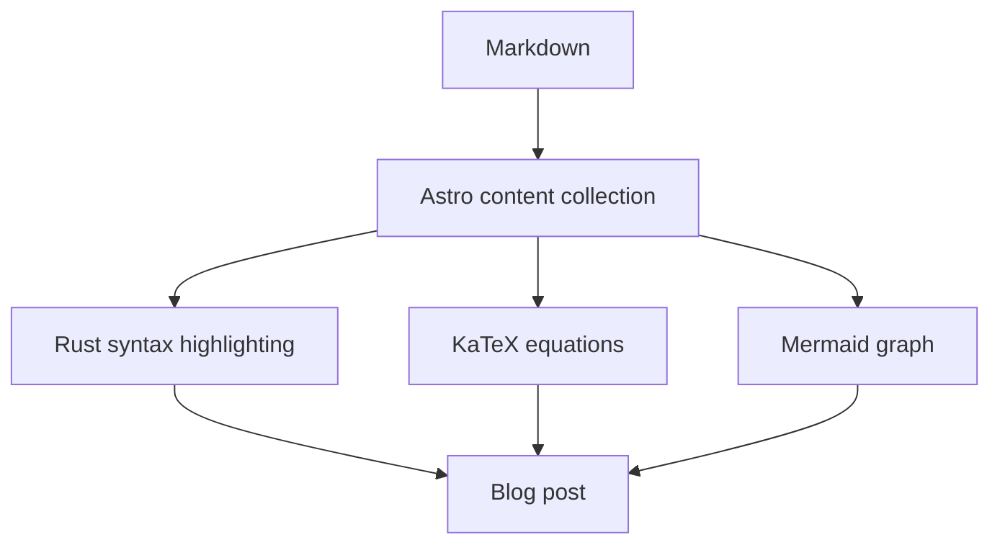

Lorem ipsum dolor sit amet, **consectetur adipiscing elit**. Sed do eiusmod
tempor incididunt ut labore et dolore magna aliqua. Ut enim ad minim veniam,
quis nostrud exercitation ullamco laboris nisi ut aliquip ex ea commodo consequat.

## Rust

Lorem ipsum dolor sit amet, _consectetur adipiscing elit_. Duis aute irure dolor
in reprehenderit in voluptate velit esse cillum dolore eu fugiat nulla pariatur.

```rust
fn sum_of_squares(n: u32) -> u64 {
    (1..=n)
        .map(u64::from)
        .map(|value| value * value)
        .sum()
}

fn main() {
    let n = 10;
    let result = sum_of_squares(n);

    assert_eq!(result, 385);
    println!("Sum of squares up to {n}: {result}");
}
```

## KaTeX

Lorem ipsum dolor sit amet, $a^2 + b^2 = c^2$, consectetur adipiscing elit.
Sed do eiusmod tempor incididunt ut labore et dolore magna aliqua.

$$
\sum_{k=1}^{n} k^2 = \frac{n(n+1)(2n+1)}{6}
$$

$$
\begin{aligned}
S(10) &= \frac{10 \cdot 11 \cdot 21}{6} \\
      &= 385
\end{aligned}
$$

## Mermaid

Lorem ipsum dolor sit amet, consectetur adipiscing elit. Integer nec odio.
Praesent libero. Sed cursus ante dapibus diam.



> Lorem ipsum dolor sit amet, consectetur adipiscing elit. Sed do eiusmod tempor
> incididunt ut labore et dolore magna aliqua.

Lorem ipsum dolor sit amet, consectetur adipiscing elit. Sed dignissim lacinia
nunc. Curabitur tortor. Pellentesque nibh. Aenean quam.
