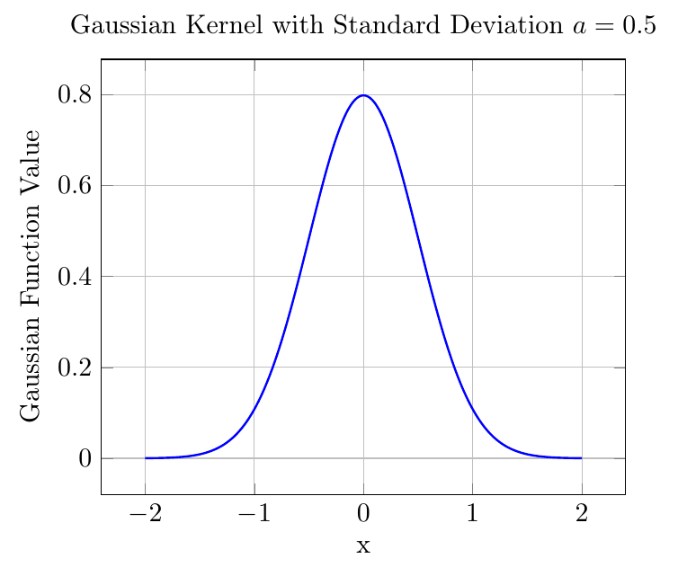
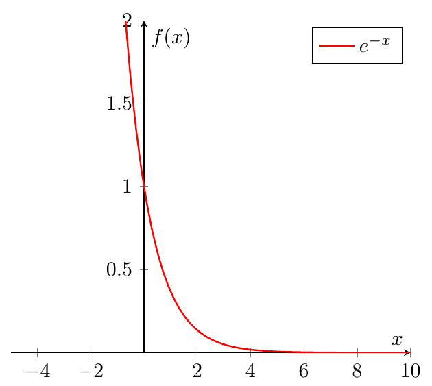
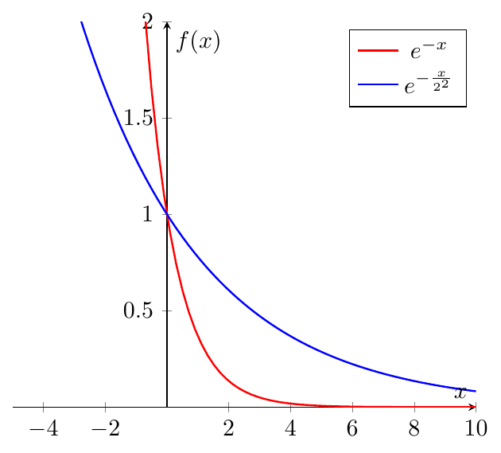
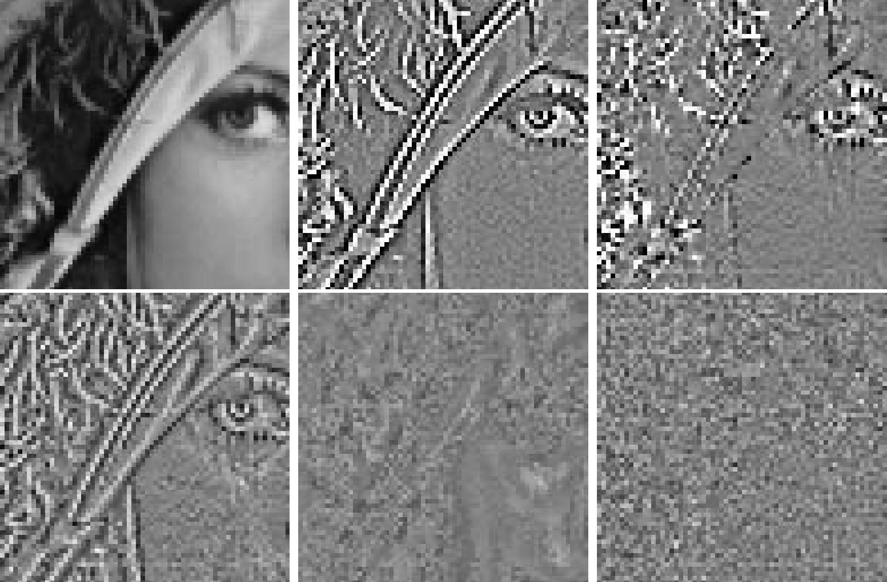
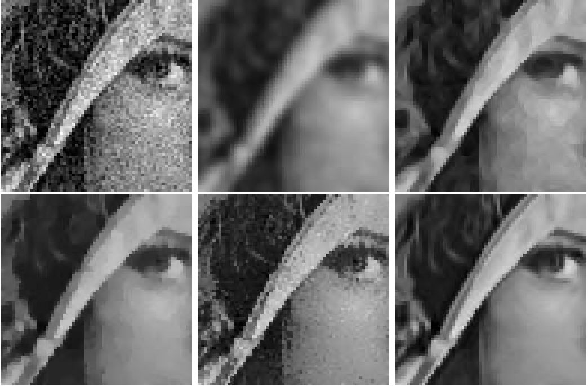
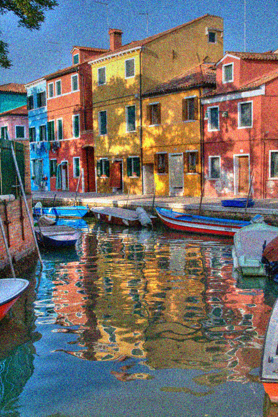
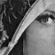
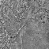
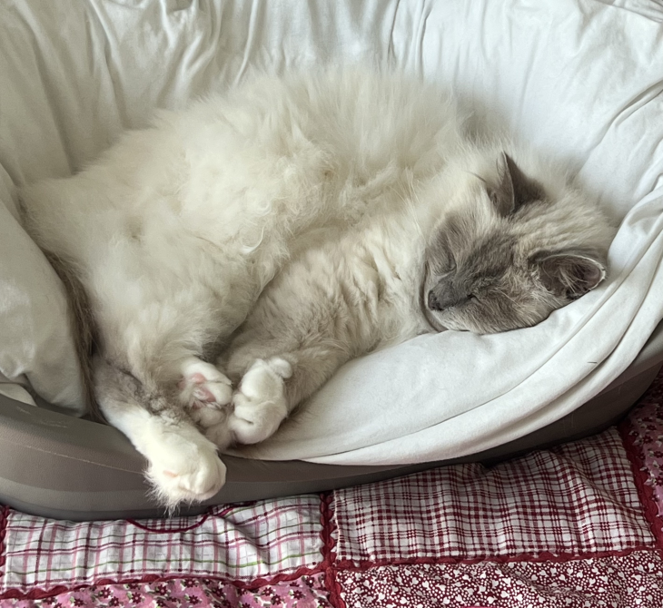
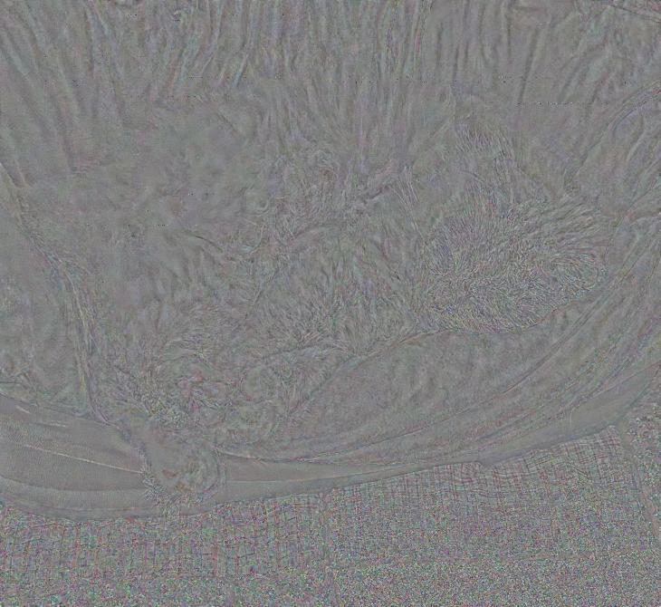

## Article synthesis

### Context

_A non local algorithm for image denoising_ \[[1](#ref-nlmeans)\] is an article about image denoising, which is the process of reducing or removing noise from a digital image or photo.\
Noise can be caused by various factor, including :

- poor lighting condition

- electronic interferences

- compression error

the article propose a new method to compare the performance of digital image denoising methods, and a new algorithm : the NL-means (non local means). The noise model used in the article to conduct algorithms benchmark is the Gaussian white noise model \[[2](#ref-wikigaussiannoise)\]. It is characterized by it’s distribution, the noise have a mean of zero and a standard deviation $\sigma$ that determines its amplitude, most of the noises values are close to the mean (0 in our case), with fewer instance as we move from zero. White Gaussian noise add a random value to pixel intensity that make the image look grainy, and simulate the effect of real noise.

### Objectives

> _the goal of image denoising methods is to recover the original image from a noisy measurement_ \[[1](#ref-nlmeans)\]

unfortunately, a lot of denoising algorithms fails to keep fine details of the original image, and the result is often blurred. The article’s purpose is to propose an algorithm capable of keeping details and structures while removing noise in a digital image. To quantify the loss of data in a image, the article propose the _method noise_.

> _Let $u$ be an image and $D_h$ a denoising operator depending on a filtering parameter $h$. Then we define the method noise as the image difference_ \[[1](#ref-nlmeans)\]
>
> $$
> u - D_hu
> $$

The _method noise_ is the difference between the original noisy image $u$ and the denoised (by operator $D_h$) output image. $h$ is the filtering parameters; it can represent a filter window size, a denoising threshold, etc.\
The method noise is interesting to benchmark denoising algorithms performance because it visually quantify the loss of quality (details, texture). If a denoising method perform well, the method noise should just contain the original image noise, and contains as little as possible of the original image. For example, if the method noise contains a structure, that mean that this strcture have been removed from the original image, and that this part of the original image will have lost details. The goal of the article with the NL-means method is to propose a performant denoising algorithm, such that structure, texture and details of the original image is kept as much as possible.

### Hypothesis

The NL-means approach is relevant to achieve a performant denoising implementation, as described by the method noise because it is a **non local** method, unlike Gaussian smoothing or nearest neighbors, which are local averaging methods, and often blur fine details and texture of the original image. The NL-means is based on the idea that a pixel in a image can be denoised by averaging, not just with the local neighborhood, but with all pixels in the image that have a similar neighborhood.

### Method

The NL-means algorithm denoise an image by replacing each pixels value with a weighted average of all other pixels values in the image.

$$
NL[v](i) = \sum_{j \in I} w(i,j)v(j)
$$

${w(i,j)}_j$ is the weight assigned to pixel $j$ when denoising pixel $i$, it depend on the similarity between the pixel $i$ and $j$. The weight is a number between 0 and 1, and the sum of all weights is 1.\
The algorithm extract the patches $N_i$ and $N_j$, which are centered, fixed size, square neighborhood around $i$ and $j$ respectively. The weight assigned to pixel $j$, when denoising pixel $i$ is,

$$
w(i,j) = \frac{1}{Z(i)}e^{-\frac{\|v(N_i) - v(N_j)\|_{2,a}^2}{h^2}}
$$

where $\|v(N_i) - v(N_j)\|_{2,a}^2$ is the weighted euclidean distance between the intensity vectors of pixels neighborhoods $N_i$ and $N_j$. The weight are scaled by a Gaussian kernel.\

The plot help us visualize the role of the Gaussian kernel: yield more weight to small euclidean distance (similar neighborhoods), and less weight to higher distances. The standard deviation of this Gaussian kernel, $a$, is a user-defined parameter that influences the decay of weights based on the similarity of pixel neighborhoods. A larger $a$ makes the algorithm less sensitive to differences (the weights decrease more slowly with increasing difference), whereas a smaller $a$ makes the algorithm more sensitive to these differences.\
$h$ known as the filtering parameters, controls the sensitivity of the algorithm to noise, a larger value of $h$ makes the algorithms less sensitive to noise, blurring the image, and a smaller value of $h$ makes the algorithm more sensitive to noise, which could preserve the image details but retain more noise.\
$Z(i) = \sum_j e^{\left(-\frac{\|v(N_i) - v(N_j)\|^2}{h^2}\right)}$ is a normalizing factor that ensure that the weights for all pixels $j$ sums to 1 for each pixel $i$.\
To visualize how to weight expression is modeled, we can plot $\exp({-\frac{x}{h^2}})$ if we put $x=\|v(N_i) - v(N_j)\|_{2,a}^2$ and $h^2 = 1$

Plot of the function $e^{-x}$

If the similarity between $N_i$ and $N_j$ is high, then $x$ tend to $0$ and $e^{-x}$ tend toward 1. Conversely, if the similarity is low, meaning $x$ get bigger, $e^{-x}$ tends to 0. The higher the similarity between $i$ neighborhood and $j$ neighborhood, the higher the weight of the pixel $j$ is.\
we can visualize role of the filtering parameters $h$, by plotting together the same expression, with $h^2 = 1$ and $h^2 = 2$

Plot of the functions $e^{-x}$ and $e^{-\frac{x}{h^2}}$ with $h=2$

With $h=2$, the function is less sensitive, in the plot, the weight decrease less rapidly when the distance between pixels intensities is getting bigger.\
Authors have fixed the value of $h$ to $10 \cdot \sigma$ where $\sigma$ is the standard deviation of the noise added to the image, and the square neighborhoods $N_i$, $N_j$ to $7 \times 7$ pixels. They also restrcited the size of the effective search window, although theoretically this search is done throughout the entire image, in practice, for computational purposes, the search window has been restricted to a $21 \times 21$ size. However, this restriction doesn’t drastically reduce the algorithm’s performance, since we can imagine that the similarities are spatially close and not distributed throughout the image. I still think that it limits the algorithm’s scope a little, since in certain types of images, patterns generalize throughout the entire figure, so looking for similarities everywhere could allow better denoising.\

### Validation method

Authors compare local smoothing function and NL-means algorithm under three criteria :

- method noise

- mean square error (euclidean difference between restored and true image)

- visual quality of restored image

if a denoising algorithm performs well, the method noise should only retain the image noise, and we shall not see clear structure because that mean that the algorithm has taken important details of the original image in the process.\
The mean square error is used to quantify the difference between the original image (not noisy) and the restored image (after denoising). A smaller mean square error indicate that the restored is closer to the original image.\
The third criteria is a non-numerical one, but is still useful to appreciate the performance of each algorithm with our eyes, because numerical criteria like MSE (mean square error) does not assure high visual quality.

### Results

Figure 4 of the article \[[1](#ref-nlmeans)\], showing the method noise for a variety of algorithms.

Figure 4 of the **original article**, method noise, from left to right and from top to bottom: original image, Gaussian filtering, anisotropic filtering, total variation minimization, neighborhood filtering and NL-means algorithm

This result show us that local smoothing algorithms remove important structure of the original image, the least efficient algorithms under this test are Gaussian smoothing, anisotropic filtering and total variation minimization, the best performing algorithm is the NL-means algorithm, because the method noise does not show clear structure, and is only composed of noise, meaning that the algorithm have not removed important details of the original image.\

| Image  | GF  | AF  | TVF | YNF | NL  |
| :----- | :-: | :-: | :-: | :-: | :-: |
| Lena   | 120 | 114 | 110 | 129 | 68  |
| Baboon | 507 | 418 | 365 | 381 | 292 |

Table 1 of the **original article** comparing MSE values for various denoising algorithms

The table show that the NL-means have the lowest MSE of all algorithms, and with a notable difference.\

Figure 5 of the **original article**. Denoising experience on a natural image. From left to right and from top to bottom: noisy image ($\sigma = 20$), Gauss filtering, anisotropic filtering, Total variation, Neighborhood filtering and NL- means algorithm.

On this last evaluation criteria, it is also NL-means that wins, it removes the most noise while not blurring the image.\

### Personal opinion

Overall, we found the article to be very well written, concise and comprehensible. The introduction of method noise, although simply defined, enables us to compare the effectiveness of different denoising algorithms, and NL-means is an extremely interesting method, as it enables non-local denoising without the need for artificial intelligence to recognize patterns in the image. However, we found the tests a little limited, and would have liked to see "method noise" and "mse" for more test images with a variety of configurations (more or less detail). We also found unfortunate that the value of $a$, the standard deviation of the Gaussian kernel used in the pixels weighting is not explicitly given in the article.\
Also, as the authors have noted in the paper published on _IPOL_ \[[3](#ref-nlmeanscode)\], we have to say that the title is a little misleading, in fact, the algorithm in its current implementation is more of a semi-local algorithm than a non-local one due to the size restriction of the search window.

## Implementation

### Fidelity

The authors have published, on the _IPOL Journal_ \[[3](#ref-nlmeanscode)\] a usable demo of the algorithm, the source code and an article explaning implementation details. Both the source code and the online version use a variant named _patchwise implementation_, of the original NL-means algorithm. The article published on _IPOL_ also explains how to process RGB images, unlike the core article, which was limited to grayscale images.

#### RGB Images

An RGB image is described as $u=(u_1, u_2, u_3)$ where $u_1, u_2, u_3$ are the red, green and blue channels. the formula for calculating the Euclidean distance between intensity vectors has been adapted to take account RGB channels.\

$$
\begin{aligned}
        & d^2(B(p,f), B(q,f)) = \\
        & \frac{1}{3(2f + 1)^2} \sum_{i=1}^{3} \sum_{j \in B(0,f)} (u_i(p +j) - u_i(q + j))^2
    \end{aligned}
\tag{1}
$$

With $u_i$ a color channel, and $B(k,f)$ the square neighborhood center at pixel $k$. the only difference with the original formula seen earlier for grayscale values, is that we make a weighted average of the differences with three channels.

#### Patchwise NL-means

In the "pixel-wise" implementation seen in the core article, each pixel $i$ in the image is individually denoised by taking the weighted average of the other pixels $j$ in the image, and the weights assigned to pixels $j$ are based on the similarity of their neighborhoods. In the patchwise implementation, on the other hand, it’s no longer individual pixels that are denoised, but patches of pixels. However, the method for calculating similarities remains the same as for the pixel wise implementation.

### Reproducibility

The source provided by the authors, both in the online and the local version, lets you load images, add noise with a customizable standard deviation value, and see the result of the algorithm.\
Being able to tune the sigma value means you can test the algorithm in different configurations. We found the online demo very complete, giving in particular the RMSE (Root Mean Square error) and the PSNR (Peek signal-to-noise ratio), two metrics used to quantifying denoising quality. The code also displays the _method noise_, which is one of the way used by the authors in the article to compare the efficiency of denoising algorithms.

### Structure

The source code is a C-make project divided into multiple c/cpp source files. Overall, I didn’t find the source code to be very well structured. There’s a lot of code reuse, for example to check that the image contains three channels. Indentation isn’t constant and variable names aren’t often well chosen. The main program’s arguments (input image path, output image path, standard deviation to be applied) are not robustly parsed, which can lead to malfunctions not necessarily cathed by the program. The code is limited to the use of three-channel RGB images with the format PNG, although the authors state that it is easily extensible for other formats. As it stands, it would not be easy to use the code for anything other than direct application of the NL-means algorithm.

## Experimentations

### Reproduced experiments

We’re going to reproduce the experiment described in the paper published on _IPOL_, as the image is credited so we can use the same one. The image of the lady in the original paper is not credited, but looking in the online demo usage archives \[[4](#ref-ipolarchive)\], a user in 2009 (possibly the author) tested the algorithm with the lady image. We therefore, are able to reproduce the experience in the original article. We’ll be doing each experiment with the online demo because the usability is better than with the local code, and we assume it is the same implementation running in the back.

### Tests configuration

The first experiences will be conducted with the same photo as **figure 1 of the IPOL article**, downloaded from Flickr, with $\sigma = 15$. Then, the same photo will be denoised, but with $\sigma = 30$. Finally, we will test the lady photo with a standard deviation of 15, showing also the _method noise_ to compare it with the one provided in the original article

### Results

- 

  original image

- 

  noisy image ($\sigma = 15$)

- 

  denoised image

NL-means denoising _Colors of Burano_ \[[5](#ref-color)\] comparaison with $\sigma = 15$

With a standard deviation equal to 15, we find that the algorithm manages to remove the noise well, while keeping the colors clear, and above all by not removing a lot of detail from the image, the textures are a little smoothed, but overall, the structure of the buildings and the color boundaries are well preserved.\

- 

  original image

- 

  noisy image ($\sigma = 30$)

- 

  denoised image

NL-means denoising _Colors of Burano_ \[[5](#ref-color)\] comparaison with $\sigma = 30$

When we push the standard deviation of the added noise to 30, which adds very aggressive noise to the image, this is where the implementation really shines, we find the result is really great.\

- 

  original image

- 

  noisy image ($\sigma = 15$)

- 

  denoised image

- 

  method noise

NL-means denoising _Lady with a hat_ \[[6](#ref-ladyhat)\] comparaison

Here too the result is impressive, the algorithm manages to remove the noise while not distorting the texture of the skin, however, the _method noise_ is a little different from the article’s one, but we where not able to find the $\sigma$ used in the article to compute the _method noise_, it may be the reason for that difference.

### Complementary experiences

We can test different images, with different contexts, such as highly detailed images, poorly detailed images, and with varying ranges of added noise. We can also test the algorithms with really noisy images, without the white Gaussian noise. This would allow us to see if the algorithm performs well in external situations.\
The additional test that we propose is with an image of a cat, which have a lot of details, this will allow us to see if the algorithm struggle to handle fine details like the cat hairs.

- 

  original image

- 

  noisy image ($\sigma = 15$)

- 

  denoised image

- 

  method noise

NL-means denoising _Beautiful cat_ \[[7](#ref-cat)\] comparaison

\
The result is quite good, although the hairs have been blurred a little, the image doesn’t lose too much detail either. The _method noise_ shows noise retention without displaying clear structures.

## References

\[1\] A. Buades, B. Coll, and J.-M. Morel. A non-local algorithm for image denoising. _2005 IEEE Computer Society Conference on Computer Vision and Pattern Recognition (CVPR’05)_. 2005. Vol. 2. pp. 60–65 vol. 2. [https://doi.org/10.1109/CVPR.2005.38.](https://doi.org/10.1109/CVPR.2005.38)

\[2\] W. contributors. Additive white Gaussian noise Wikipedia. 2023. [https://en.wikipedia.org/w/index.php?title=Additive_white_Gaussian_noise. ](https://en.wikipedia.org/w/index.php?title=Additive_white_Gaussian_noise)Online; accessed 24-November-2023

\[3\] A. Buades, B. Coll, and J.-M. Morel. Non-Local Means Denoising. _Image Processing On Line_. 2011. Vol. 1. pp. 208–212. <https://doi.org/10.5201/ipol.2011.bcm_nlm>

\[4\] IPOL online demo archive. [https://ipolcore.ipol.im/demo/clientApp/archive.html?id=55&page=4.](https://ipolcore.ipol.im/demo/clientApp/archive.html?id=55&page=4)

\[5\] H. BRY. Colors of Burano. [https://www.flickr.com/photos/setaou/2162752903/. ](https://www.flickr.com/photos/setaou/2162752903/)Accessed: 29/10/2023

\[6\] Unknown. Lady with hat. [https://ipolcore.ipol.im/api/archive/staticData/blobs/b/c/bc22f841464ab2b6432cc6185bd509208980af22.png. ](https://ipolcore.ipol.im/api/archive/staticData/blobs/b/c/bc22f841464ab2b6432cc6185bd509208980af22.png)Accessed: 29/10/2023

\[7\] A. PELFRESNE. Beautiful Cat.
