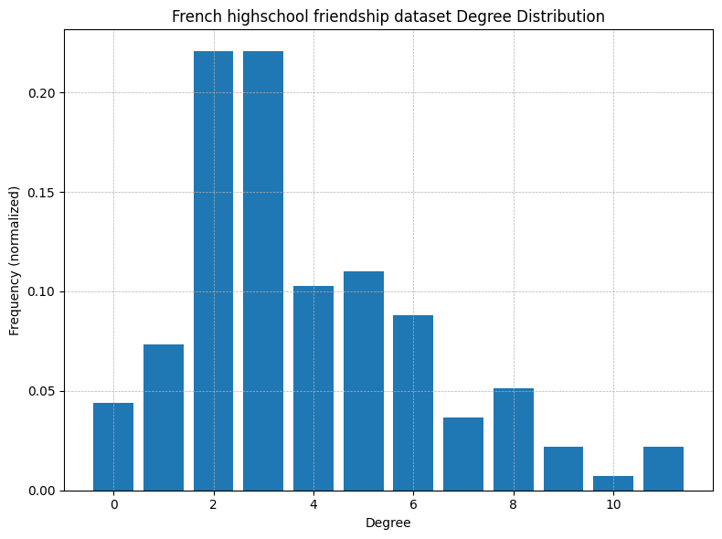
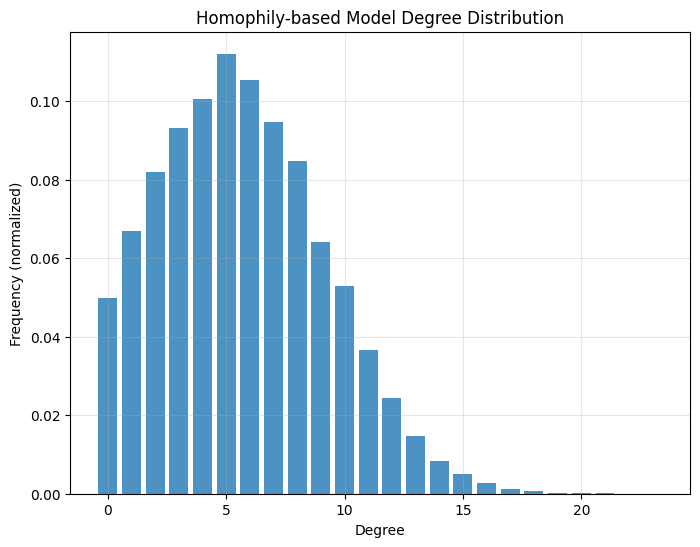

> [!NOTE]
> This page adapts a report I wrote for the _“Complex and Social Network”_ course in the Master in Innovation and Research in Informatics at the Facultat d’Informàtica de Barcelona. The original report is linked above under “Original material source.”

## Abstract

This research project presents a generative model for social network formation based on homophily and triadic closure. The model generates network structures by evaluating agent similarity metrics and shared neighborhood relationships. Generated networks exhibit high clustering coefficients, sparse connectivity, and positive assortativity. Validation is made against high school friendship network dataset. Statistical analysis shows the model produces significantly higher clustering and assortativity compared to random graph models ($p < 0.05$). The model's parameterization enables generation of artificial social networks while maintaining realistic structural properties, supporting research on social network dynamics and relationship formation mechanisms.

Keywords: Social Networks · Homophily · Random graph · Triadic Closure · Network model

## Introduction

### Motivations

Network science has made significant strides in understanding complex systems through computational models that capture essential properties of real-world networks. The classical models - Erdős-Rényi random graphs [\[3\]](#reference-3), Watts-Strogatz small-world networks [\[10\]](#reference-10), and Barabási-Albert preferential attachment [\[1\]](#reference-1) - have demonstrated how simple rules can generate networks with specific structural properties observed in real systems. Throughout this course, I developed a strong interest in those computational models that let properties emerge through simple rules. Another exciting driver for me is the sociological process of creating links and relations with others. We may think they're arbitrary, that we choose with whom we are creating those links, but we're ultimately governed by biases that shape the way we form social relationships.

I saw an opportunity, with the research project, to create my own model, based on underlying social behaviors - specifically how people form friendships in real life. The model implements two social mechanisms that explain how people form friendships: homophily and triadic closure. Homophily describes how individuals connect with others who share similar characteristics. This occurs in two ways: through shared environments (induced homophily), such as workplaces where similar people naturally meet, and through 'active choices' (choice-based homophily), where people seek connections with similar others. Despite being called "choice-based" homophily, this connection preference is rarely conscious. People's social connections emerge from subtle biases and unconscious preferences for similar others, rather than deliberate choices about whom to be friend based on shared traits. Research consistently shows this "birds of a feather" effect across various social settings, from schools to professional networks.

Triadic closure represents how mutual friends become connected - the "friend of my friend" effect. When people socialize in groups, they naturally meet and bond with their friends' other friends, creating clustered social circles.

I developed an undirected, generative model based on those two social mechanism - homophily and triadic closure. Drawing from foundational random graph theories, I implemented simple rules that let possible the creation of networks with similar structural properties found in empirical friendship data.

### Measuring a relationship network

Clustering Coefficient measures how much nodes tend to form tightly-knit groups. Social networks show high clustering as friends often form dense local communities. This reflects how people typically maintain close-knit social circles.

It is given by:

$$
C(v) = \frac{2 \times T(v)}{k_v \cdot (k_v - 1)}
\tag{1}
$$

where:

- $C(v)$ is the local clustering coefficient of node $v$,

- $T(v)$ is the number of triangles involving node $v$,

- $k_v$ is the degree of node $v$.

The **average clustering coefficient** of a graph is the mean of $C(v)$ over all nodes $n$:

$$
C_{\text{avg}} = \frac{1}{n} \sum_{v \in V} C(v)
\tag{2}
$$

Network Density represents the proportion of possible connections that actually exist. Social networks have low density because people maintain limited numbers of meaningful relationships, even as the network grows larger. This reflects the practical constraints on maintaining social bonds.

It is given by:

$$
D = \frac{2 \cdot |E|}{|V| \cdot (|V| - 1)}
\tag{3}
$$

where:

- $D$ is the density of the graph,

- $|E|$ is the total number of edges in the graph,

- $|V|$ is the total number of nodes in the graph.

Density [3](#eq-density) is not a metric that will differentiate our model from a random graph such as ER [\[3\]](#reference-3), but it is used to direct the search for parameters and to converge towards a network with a high clustering rate without ending up with a complete graph.

Network assortativity reflects patterns in how nodes connect based on their degree. In social networks, we typically observe weak positive assortativity ($0.1$-$0.4$), indicating people tend to form friendships with others of similar social activity levels, but this tendency isn't strong. Networks with negative assortativity ($-0.1$ to $-0.5$) show high-degree nodes primarily connecting to low-degree nodes, common in technological infrastructures like power grids. Strong positive assortativity ($> 0.5$) creates highly segregated communities where popular individuals cluster together while less connected nodes form separate groups. This property helps characterize network type and formation processes - social networks rarely show strong positive or negative assortativity, instead maintaining a moderate positive value that allows for social mixing while preserving some degree-based affinity.

It is given by:

$$
r = \frac{\sum_{i} j_i k_i - \frac{1}{M} \left( \sum_{i} \frac{1}{2} (j_i + k_i) \right)^2}{\sum_{i} \frac{1}{2} (j_i^2 + k_i^2) - \frac{1}{M} \left( \sum_{i} \frac{1}{2} (j_i + k_i) \right)^2}
\tag{4}
$$

where:

- $r$ is the degree assortativity coefficient,

- $j_i$ and $k_i$ are the degrees of the nodes at either end of the $i$-th edge,

- $M$ is the total number of edges in the graph.

Social networks also show a characteristic pattern in their degree distribution - how many connections each person has. The distribution typically follows a right-skewed shape, with many people having a moderate number of connections and fewer people having very high numbers of connections. This differs from both random networks (which show a normal distribution) and scale-free networks (which follow a power law). The pattern reflects how most people maintain a manageable number of social relationships, while a few highly social individuals maintain larger networks. We also use this degree distribution pattern to validate our model's output against real social network data.

In addition to those metrics, I tuned my model parameters by targeting the empirical network's average degree. While it can vary from networks to networks and is not the structural essence of a relationship network, it has guided me to generate a network of compatible size and to my empirical data set, ensuring I have a comparison point.

My model generates networks exhibiting those studied metrics of empirical friendship data: high clustering coefficient, low density, and weak positive assortativity. The simulated networks also reproduce the right-skewed degree distribution observed in the empirical dataset.

## Related Work

Random network models have provided key insights into network formation through simple mechanisms. The Erdős-Rényi model [\[3\]](#reference-3) introduced random link creation. Watts-Strogatz [\[10\]](#reference-10) demonstrated how local clustering and short paths emerge from rewiring local connections. Barabási-Albert [\[1\]](#reference-1) showed how preferential attachment generates scale-free degree distributions. Later models like Bianconi-Barabási [\[2\]](#reference-2) added node fitness to explain competitive dynamics. Empirical studies have extensively documented homophily in real social networks. McPherson et al.'s [\[7\]](#reference-7) landmark review showed how similarity shapes connections across race, age, education, and other attributes. Studies in schools, workplaces, and online platforms consistently find that people form stronger ties with similar others. Recent work [\[5\]](#reference-5) using digital traces and social media data has quantified homophily's effects on network structure and information flow. However, few computational models directly incorporate homophily as a primary mechanism. Most focus on structural properties rather than the social processes driving tie formation. This gap between empirical observations and theoretical models motivates my research.

One of the few works on homophily based computational model is Mele's [\[8\]](#reference-8) work, developing a structural model of network formation, incorporating homophily and community structure through unobserved types and strategic interactions. His contribution is showing how network formation converges to a hierarchical exponential random graph and providing a Bayesian estimation framework. While his model effectively captures homophily and clustering in empirical networks, it differs from my approach. My model directly implements social mechanisms through similarity scoring and explicit triadic closure, focusing on network growth dynamics rather than equilibrium estimation. I also combine induced and choice-based homophily through constrained node exposure, better reflecting how real social connections form through both environmental constraints and personal choices.

### Empirical comparison

I use the high school friendship network dataset [\[6\]](#reference-6) because it provides a great test bed environment and a realistic target to reach for a real life scenario of strong social relations. This directed, unweighted network is based on student surveys and reflects real friendship declarations in a French high school near Marseille, in 2013. With 181 students, the dataset is large enough for analysis but still computationally manageable. High school environments are ideal for studying homophily because they show both class-based homophily, influenced by institutional structures, and preference-based homophily, shaped by individual choices. Furthermore, the well-defined boundaries of the school help minimize external factors that could affect friendship formation, making the dataset highly relevant for my study.

I chose this dataset of friendships because I think its structural properties are more interesting than the collaboration network [\[9\]](#reference-9), which doesn't really reflect the true social relationships of the collaborating authors, but often a strategic and careerist desire. A friendship in high school is, on the contrary, motivated by the intrinsic realities of the students.

My model assumes undirected relationships, meaning that a connection between two nodes exists only if it is mutual. To align the high school friendship network with this assumption, I transformed the dataset by considering a relationship valid only when both students, $u$ and $v$, explicitly declared each other as friends. This ensures that the network consider only reciprocal ties, which are more stable and meaningful in the context of our model's mechanisms. This transformation also eliminates potential noise from one-sided declarations.

## Model Description

Each node $i$ represents an individual in a social network and is associated with a set of categorical attributes $\mathcal{F}_i$. These attributes reflect real-world categories such as occupation, cultural interests, or neighborhood affiliation. We posit that nodes sharing more attributes are more likely to connect, following the principle of homophily, which holds that similarity fosters interpersonal ties. Additionally, we incorporate triadic closure, the tendency that two people with a mutual acquaintance are more likely to form a tie.

Each node $i$ has a set of features $\mathcal{F}_i$. We measure the pairwise similarity between nodes $i$ and $j$ using the Jaccard coefficient:

$$
\text{Sim}(i, j) = \frac{|\mathcal{F}_i \cap \mathcal{F}_j|}{|\mathcal{F}_i \cup \mathcal{F}_j|}
\tag{5}
$$

Larger values of $\text{Sim}(i, j)$ indicate that the two nodes share a greater proportion of their attributes. The given $\text{Sim}(i, j)$ is normalized.

To determine whether an edge forms, we convert the similarity score into a probability using a logistic function:

$$
p_{\text{base}}(i, j) = \frac{1}{1 + \exp(-\beta[\text{Sim}(i, j) - \delta])}
\tag{6}
$$

where $\beta$ (the "steepness") controls how sharply changes in similarity translate into probability, and $\delta$ (the "shift") moves the midpoint of the logistic curve to the left or right.

I chose the logistic function to map similarity scores to connection probabilities because forming social relationships based on homophily is not a linear process. In real-life social networks, small differences in similarity may have little impact on connection likelihood at low similarity levels, but once a threshold is reached, the probability of forming a connection increases rapidly. The logistic function captures this non-linear behavior, allowing for a gradual increase in connection likelihood for low similarity scores, followed by a sharp rise around a critical similarity threshold, and eventually leveling off as similarity approaches its maximum.

Once a new node $i$ appears, it is introduced to a limited set of existing nodes (e.g., a group of randomly chosen acquaintances and their neighbors). When considering a potential edge to an already-visible node $j$, we account for the number of shared neighbors $n_{\text{shared}}$ that $i$ and $j$ already have in common:

$$
p_{\text{final}}(i, j) = \min(1, p_{\text{base}}(i, j) + \gamma \cdot n_{\text{shared}})
\tag{7}
$$

where $\gamma$ is the "triadic closure strength" indicating how strongly mutual acquaintances increase the likelihood of a new connection.

#### Model parameters

- $n$: The total number of nodes in the final network.

- $n_0$: The number of initial nodes used to "seed" the network.

- $k$: The number of acquaintances each new node consults upon entering the network (plus their neighbors).

- $\beta$: A steepness parameter for the logistic function (controls how quickly similarity maps to connection probability).

- $\delta$: A shift parameter for the logistic function (positions the logistic curve).

- $\gamma$: A triadic closure coefficient controlling how much mutual acquaintances boost edge formation.

- $\mathcal{F}$: The network includes a number of feature categories, each representing a dimension of similarity (e.g., shared interests or characteristics). For each category, the number of features can be specified, allowing for control over the granularity of similarity calculations. These parameters define the structure and complexity of the feature space, which directly influences the homophily-based edge formation process.

This model design captures previously discussed tendencies, namely that (1) individuals are drawn to those who share similar defining characteristics, and (2) meeting through a common contact increases the propensity for new, direct ties.

## Results

### Empirical data

The empirical dataset from a high school friendship network corroborate the previously discussed properties. It has a low density ($0.029$), with students connecting to only a small fraction of possible peers. The high clustering coefficient ($0.539$) indicates strong friend-of-friend relationships, where students form tight-knit social groups. Students maintain on average $3.85$ friendships. The positive assortativity ($0.413$) shows students tend to befriend others with similar numbers of connections, though this tendency remains moderate.

The degree distribution of our empirical high school friendship network [1](#fig-empirical-degree-distribution) shows a right-skewed pattern typical of social networks. Most students maintain $2$-$3$ friendships, with fewer students having very high numbers of connections. This distribution differs from both random networks (which would show a normal distribution) and scale-free networks (which would follow a power law), aligning with known patterns in friendship networks.

Fig. 1. Declared friendship in a French Highschool degree distribution

### Model

The model simulates a social network of $n=150$ nodes, initialized with $n_0=20$ seed nodes. Each new node is presented to $k=25$ an already existing node in the network, reflecting a realistic upper bound on active friendships. The logistic function parameters ($\beta=19$, $\delta=0.65$) create a sharp, right shifted threshold for connection formation based on similarity, while the moderate triadic closure strength ($\gamma=0.065$) have a balanced influence of shared connections. The identity of each node is defined by three categorical features $\mathcal{F}_i$, each with three possible values, creating $3^3=27$ possible feature combinations. These parameters balance between network sparsity and sufficient connectivity for community formation.

Table 1. Model Parameters for the Triadic Homophily Graph results

|       **Parameter**        |   **Symbol**    | **Description and Value**                                           |
| :------------------------: | :-------------: | :------------------------------------------------------------------ |
|        Total nodes         |       $n$       | 150                                                                 |
|       Initial nodes        |      $n_0$      | 20                                                                  |
| Acquaintances per new node |       $k$       | 25                                                                  |
|         Steepness          |     $\beta$     | 19 (controls how quickly similarity maps to connection probability) |
|           Shift            |    $\delta$     | 0.65 (positions the logistic curve)                                 |
|  Triadic closure strength  |    $\gamma$     | 0.065 (boosts connection probability based on shared neighbors)     |
|     Feature categories     | $\mathcal{F}_i$ | 3 feature category with 3 possible value for each category.         |

The generated networks ($n=150$) averaged over $t = 200$ runs have a clustering coefficient of $0.47 \pm 0.03$, density of $0.04 \pm 0.004$, assortativity of $0.39 \pm 0.11$, and average degree of $5.71 \pm 0.57$.

These metrics show a slightly less strong clustering coefficient compared to the empirical results and the average degree is a little higher, but we can still consider them satisfactory, particularly in view of its accurate assortativity.

The model generates a degree distribution averaged over $t = 200$ run [2](#fig-model-degree-distribution), that follows the same right-skewed pattern, with a slightly higher average degree at $5$-$6$ connections. The distribution shows more spread than the empirical data, extending up to 20 connections, but maintains the characteristic social network property of having few nodes with very high degrees. The presence of nodes with zero connections and the gradual tail decay suggests my model captures both social isolation and the limits on friendship formation.

Fig. 2. Model degree distribution

](../../assets/projects/homophily-and-triadic-closure/model_example_generation.png)

Fig. 3. Example network generation with the fine-tuned parameters: [1](#tab-parameters)

The visualized network [3](#fig-example-generationl) have clear community structures with dense local clusters. Several highly connected cores are visible, surrounded by less connected peripheral nodes. The presence of isolates and small components mirrors empirical patterns. We also observe the presence of Hub transiting nodes, which is also present in our empirical friendship graph.

### Significance

To evaluate the statistical significance of the observed metrics in my model, we conducted a p-value test by comparing the results against a null model based on Erdős–Rényi random graphs. The null hypothesis ($H_0$) posits that the observed network metrics, specifically the clustering coefficient and assortativity, are consistent with what would be expected in a random network with similar density. The alternative hypothesis ($H_1$) asserts that the observed metrics significantly differ from the null model, indicating that the structure of the network is not random and is shaped by the underlying principles of homophily and triadic closure in the model.

We focused on clustering coefficient and assortativity for the p-value test because these metrics are directly characteristic of the alternative hypothesis ($H_1$). Specifically, $H_1$ asserts that the network's structure is shaped by the principles of homophily and triadic closure, which are inherently tied to the formation of tightly-knit clusters and positive assortative mixing. Other metrics, such as average degree, while useful in guiding parameter selection during model development, are not as representative of the hypothesis. For example, the average degree reflects the overall connectivity of the network, but it does not capture the nuanced patterns of local clustering or the preferential mixing of similar nodes that my model seeks to explain. By focusing on clustering and assortativity, we ensure that the p-value test evaluates the metrics most relevant to the core principles underlying the model.

The simulation, averaged over $n = 200$ runs, yielded an observed mean clustering coefficient of $0.461 \pm 0.027$ and a mean assortativity of $0.374 \pm 0.125$. Both metrics showed $p$-values of $0$, meaning that the likelihood of obtaining these results under the null hypothesis is effectively zero. These findings strongly reject the null hypothesis, confirming that the clustering and assortative mixing patterns observed in the network are statistically significant and distinct from random graphs. This highlights the role of the model's design in shaping meaningful network structures.

## Discussion

### Results

The results are highly encouraging. My model successfully generates networks with a high clustering coefficient, while maintaining a low density and positive assortativity; however, the generated networks exhibit a higher average degree compared to the empirical dataset. Fine-tuning the parameters to reduce this average degree mechanically introduced a decline in clustering. I haven't managed to find a happy medium that fully satisfies me.

The graphical interpretation of the networks reveals distinct communities and disconnected components, reflecting the structure of social networks where not everyone belongs to a single interconnected group. This aligns well with the nature of social relationships. Nonetheless, it is worth noting that the number of disconnected components in our generated networks is lower than that observed in the empirical data. This suggests that while the model captures key features of social networks, further refinement may be needed to fully replicate the fragmentation seen in the real-world dataset.

I chose to introduce locality in my network model to enforce this disconnected component creation. When a new node $i$ appears, it is connected only to a limited set of existing nodes - specifically, a group of randomly chosen acquaintances and their neighbors. This ensures that connections are formed within a localized context, which boost shared neighbors and preserve the cohesiveness of groups. In contrast to a global approach like Barabási's [\[1\]](#reference-1), where every node is evaluated for connection based on a probability, would dilute the model's ability to replicate the natural formation of tight-knit social clusters. By restricting the pool of potential connections, we align the model more closely with the localized and community-oriented nature of real-world relations. I note, however, that this is not the only way of obtaining localised results. For example, we could have made nodes already present in our graph meet at random and create connections in this way, which is used in Mele's [\[8\]](#reference-8) work.

Early experiments relying solely on homophily failed to replicate key network properties. Incorporating triadic closure was needed, enabling the model to produce networks that align with empirical metrics. This underscores the importance of friend-of-friend relationships in the formation of social networks. This reinforces the idea that the homophily observed in empiric networks is one of the generative components of these topologies, without being the only ingredient. Furthermore, the model abstracts homophily categories into a numerical interface without assigning weights, treating all features equally. While real-world social links often give varying importance to different features, the decision to keep the model unweighted was made to maintain simplicity and focus on the core mechanisms.

### Complexity

Initially designed as a minimalistic approach, the model evolved to include multiple parameters to better capture the complexity of real-world network dynamics. However, the overall number of parameters required to achieve accurate results is higher than anticipated at the start of this research. To address this, it is important to simplify the model by fixing certain parameters to reasonable defaults or exploring alternatives to simplify some aspects of its design. Reducing the complexity of the user-facing API without compromising the structure and quality of the generated networks will be a key step in making the model more practical and accessible while retaining its ability to reproduce realistic social network properties.

### Distribution Significance

I didn't perform a statistical significance test on the degree distribution, and was only able to visually compare the results and the average degree. This work should have been done for more rigorous results, but I ran out of time for this part and my lack of mathematical and statistical background limited me in this approach.

## Methods

### Empirical data collection

For our empirical dataset, students reported their friends through a survey conducted in a French high school. We operationalized reciprocal friendships - where both students named each other as friends - as edges in our network. This dataset exhibits characteristic social network properties: dense local clusters indicating friend groups, isolated students, and a heterogeneous degree distribution that reflects varying levels of social connectivity. These structural features emerge naturally in the model through homophily-based attachment and triadic closure mechanisms.

### Model optimization

I used NetworkX [\[4\]](#reference-4) in Python to implement the model due to its easy-to-use tools for constructing and analyzing complex networks. NetworkX provides efficient handling of graph structures and built-in functions for computing key metrics, making it an ideal choice for prototyping and testing our approach. However, the model is not language-dependent and can be implemented in any programming language. The optimization requirements are minimal, relying only on a data structure capable of maintaining an adjacency list and support for bitset operations to efficiently handle feature representations.

The model's performance was significantly optimized by replacing Python sets with bitset operations for tracking connections and computing triadic closures. Using bit arrays to represent node relationships reduced memory usage and allowed faster set operations through bitwise manipulation.

### Parameters Fine-Tuning

I initially used random search to explore the parameter space by sampling values across broad ranges and evaluating each set of parameters using a distance function that measured how closely the resulting network matched desired metrics. I retained the parameter sets that produced the lowest scores, effectively narrowing down to the most promising configurations. While methods like grid search or other optimization techniques could have been employed, random search was a practical choice given the high number of parameters and the limited number of achievable metrics. This approach allowed for efficient exploration without becoming computationally prohibitive. After identifying the best-performing parameters, I fine-tuned them manually to further optimize the model's alignment with real-world network properties.

## Conclusion

This research successfully developed and validated a network formation model that captures key structural properties of social networks, including high clustering, low density, and positive assortativity. By integrating homophily and triadic closure as generative mechanisms, the model effectively reproduces the complex patterns observed in empirical datasets, such as tightly-knit communities and disconnected components. Statistical significance tests further confirmed the model's ability to generate meaningful networks distinct from random graphs.

Despite these successes, the model's reliance on multiple parameters introduces complexity that was higher than initially anticipated. Simplifying the parameter space, either by fixing defaults or exploring alternative implementations, will be critical for enhancing usability and accessibility while retaining its ability to replicate realistic network properties. Additionally, while the model treats all homophily features equally, incorporating weighted features could improve its alignment with real-world dynamics, where certain traits hold more importance in connection formation.

Overall, this research highlights the generative power of combining homophily and triadic closure, offering a flexible framework for exploring the underlying processes of social network formation and its emergent properties. Future work will focus on refining the model and expanding its applicability to broader network contexts.

## References

[1] Albert-László Barabási and Réka Albert. “Emergence of Scaling in Random Networks”. In: Science 286.5439 (1999), pp. 509–512.

[2] Ginestra Bianconi and Albert-László Barabási. “Competition and Multiscaling in Evolving Networks”. In: Europhysics Letters (EPL) 54.4 (2001), pp. 436–442.

[3] Paul Erdős and Alfréd Rényi. “On Random Graphs I”. In: Publicationes Mathematicae (Debrecen) 6 (1959), pp. 290–297.

[4] Aric A. Hagberg, Daniel A. Schult, and Pieter J. Swart. “Exploring Network Structure, Dynamics, and Function using NetworkX”. In: Proceedings of the 7th Python in Science Conference. Ed. by Gaël Varoquaux, Travis Vaught, and Jarrod Millman. Pasadena, CA USA, 2008, pp. 11–15.

[5] Gueorgi Kossinets and Duncan J Watts. “Origins of homophily in an evolving social network”. In: American Journal of Sociology 115.2 (2009), pp. 405–450.

[6] Rossana Mastrandrea, Julie Fournet, and Alain Barrat. “Contact Patterns in a High School: A Comparison between Data Collected Using Wearable Sensors, Contact Diaries and Friendship Surveys”. In: PLOS ONE 10.9 (Sept. 2015), pp. 1–26. doi: [10.1371/journal.pone.0136497](https://doi.org/10.1371/journal.pone.0136497). url: <https://doi.org/10.1371/journal.pone.0136497>.

[7] Miller McPherson, Lynn Smith-Lovin, and James M Cook. “Birds of a feather: Homophily in social networks”. In: Annual Review of Sociology 27 (2001), pp. 415–444.

[8] Angelo Mele. “A Structural Model of Homophily and Clustering in Social Networks”. In: Journal of Business & Economic Statistics 40.1 (2021), pp. 1–13. doi: [10.1080/07350015.2021.1930013](https://doi.org/10.1080/07350015.2021.1930013).

[9] Mark EJ Newman. “The structure of scientific collaboration networks”. In: Proceedings of the national academy of sciences 98.2 (2001), pp. 404–409.

[10] Duncan J. Watts and Steven H. Strogatz. “Collective dynamics of 'small-world' networks”. In: Nature 393 (1998), pp. 440–442.
