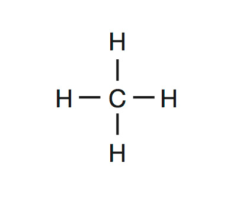
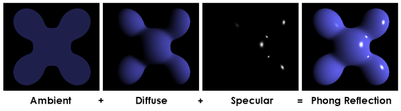
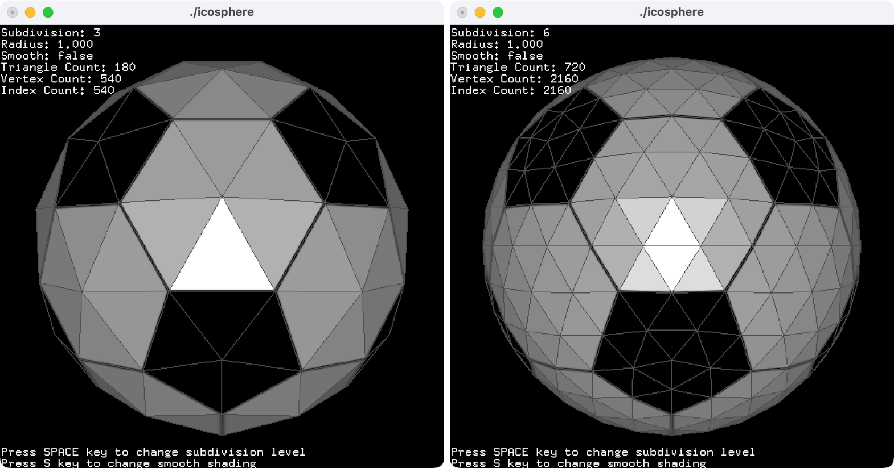

## About

I built this Rust program for the Scientific Visualization course of the Master in Innovation and Research in Informatics at the Facultat d’Informàtica de Barcelona. It loads molecules in the <a href="https://en.wikipedia.org/wiki/Protein_Data_Bank_(file_format)">Protein Data Bank (PDB) format</a>, renders them using the Phong lighting model, and lets users rotate them with Shoemake’s arcball controls. It runs on desktop with OpenGL and in the browser with WebGL and WebAssembly.

## Showcases

Tadaaa, Methane molecule, at least a simplified version of a Methane molecule, containing only atoms and bonds.

You can grab the model with your mouse to make it rotate, you can zoom with a mouse scroll (sorry mobile users :())

<web-demo data-src="/demos/molecular-visualization/" data-molecule="/demos/molecular-visualization/pdb/methane.pdb" data-title="Methane visualization"></web-demo>

Initially, the program ran only on desktop with OpenGL. I adapted it to compile to WebAssembly so it could also run locally in your browser.

- WebAssembly runs the compiled Rust code, which parses molecules, prepares atoms and bonds, calculates camera and rotation matrices, and issues drawing commands.
- WebGL provides access to the GPU, which executes the vertex and fragment shaders to render the molecules.

## Representation

Pretty close to the lewis representation of the methane molecule
<span id="lewis-methane"></span>



Here is the PDB file we have loaded.

```txt
ATOM      1  C   MET A   1       0.000   0.000   0.000  1.00  0.00           C
ATOM      2  H1  MET A   1       1.090   0.000   0.000  1.00  0.00           H
ATOM      3  H2  MET A   1      -0.363   0.000   1.028  1.00  0.00           H
ATOM      4  H3  MET A   1      -0.363  -0.890  -0.514  1.00  0.00           H
ATOM      5  H4  MET A   1      -0.363   0.890  -0.514  1.00  0.00           H
TER       6      MET A   1
CONECT    1    2    3    4    5
CONECT    2    1
CONECT    3    1
CONECT    4    1
CONECT    5    1
END
```

It lists the atoms (`ATOM`) and bonds (`CONECT`), along with each atom’s element and position in 3D space, with the molecule centered at (0, 0, 0).

## Phong

How does the lighting system work ?

The Phong shading model combines three lighting contributions at each point on the surface:

1. Ambient: base level of illumination, without it, the model is not visible.
2. Diffuse: makes surfaces facing the light brighter.
3. Specular: creates shiny highlights, it depend on the light direction and viewing angle.

<span id="phong"></span>



To compute those light contributions, we need a light source in the molecule's virtual world.
For all the visualizations on the program, the light is placed above the model.

## Shoemake arcball model rotation

Ken Shoemake, who introduced the technique, summarizes it :

> Arcball is an input technique for 3D computer graphics,
> using a mouse to adjust the spatial orientation of an object.

See <a href="https://graphicsinterface.org/wp-content/uploads/gi1992-18.pdf">the original paper</a> for implementation

### Complex

Can you guess which molecule this visualization show ?

<web-demo data-src="/demos/molecular-visualization/" data-molecule="/demos/molecular-visualization/pdb/complex.pdb" data-title="Complex visualization"></web-demo>

This molecule doesn’t exist, I created it to test performance on a very large structure. But unless you are rocking a potato build as a computer, it still runs smoothly! Thanks to the imposter technique.

But before, what performance problem could we encounter? This article was written one month before GTA VI and it seems performance issue is not a problem with our modern computers.

We usually render 3D objects using triangles, that combine to form a mesh. Our atoms are spheres, they have smooth, curved surfaces. We can approximate those surfaces with triangles, but the smoother the surface, the more triangles we need.

Take a look at this image , the sphere on the left uses 180 triangles; the one on the right uses 720.

<span id="sphere"></span>



On the complex molecule, for the atoms alone, supposing we use a sphere mesh with 720 triangles per atom:

$$
\begin{aligned}
N_{\text{triangles}}
&= N_{\text{atoms}} \times T_{\text{sphere}} \\
&= 4{,}364 \times 720 \\
&= 3{,}142{,}080
\end{aligned}
$$

where:

- $N_{\text{triangles}}$ is the total number of triangles.
- $N_{\text{atoms}}$ is the number of atoms, each represented by one sphere.
- $T_{\text{sphere}}$ is the number of triangles per sphere.

So more than three millions triangles to draw per frame, this is a lot of work for our computer, in a single frame (remember we need at least 60 frame per second to be smooth).

## Lies

The impostor technique is a trick to our mind, we think we see a 3D sphere where, there is only a flat rectangle.

It’s like going to the cinema: the people and props appear on the screen, but none of them are there. We see a projection of a scene into the flat cinema screen.

For each atom, the impostor uses a _billboard_: a rectangle that faces the camera, made of two triangles. Inside that rectangle, we create the illusion of a smooth sphere.

To build that illusion, the Rust program supplies each atom’s position, radius, and color to the GPU:

```txt
center = (x, y, z)
radius = r
color = (red, green, blue, alpha)
```

It also supplies the model, view, and projection matrices, along with the camera and light positions.

The vertex shader places the billboard’s four corners. The GPU rasterizes its two triangles into fragments, which are potential contributions to the pixels on the screen.

For each fragment, the fragment shader computes a ray–sphere intersection. If the ray misses the sphere, it discards the fragment. Otherwise, it calculates the surface position and normal, applies the Phong lighting model, and writes the resulting color and depth.

Depth testing determines which surfaces are visible when atoms overlap.

The result looks like a sphere, but its mesh contains only two triangles.

### Glucose

That it! Before you go, please take this little snack.

<web-demo data-src="/demos/molecular-visualization/" data-molecule="/demos/molecular-visualization/pdb/glucose.pdb" data-title="Glucose visualization"></web-demo>

### References

<https://raw.org/code/trackball-rotation-using-quaternions/>

<https://www.opengl-tutorial.org/intermediate-tutorials/billboards-particles/billboards/>

<https://www.3dgep.com/understanding-the-view-matrix/>

<https://paroj.github.io/gltut/Illumination/Tutorial%2013.html>

<https://paroj.github.io/gltut/>

<https://williams.chemistry.gatech.edu/structure/small_molecules/>

<https://en.wikipedia.org/wiki/CPK_coloring>

<https://github.com/douweschulte/pdbtbx/issues/80>

<https://graphicsinterface.org/wp-content/uploads/gi1992-18.pdf>
