> [!NOTE]
> This project page adapts a report we wrote with Alexis VAPAILLE for the _“Deep Learning”_ course in ESIEE Paris. The original report is linked above under “Original material source.”
>
> Alexis has since improved the code with:
>
> - reorganized layer modules.
> - f32 tensor system with storage, layouts, strides, and tensor operations.
> - macOS Metal GPU backend.
> - updated layer APIs, and device selection
> - confusion matrices and expanded classification metrics, including macro/weighted precision, recall, and F1.

## Play

Before dive deeping, please try out our neural net (magic) capabilities! It run locally in your browser, with the help of WebAssembly

<web-demo data-src="/demos/neural-network/" data-title="Draw a digit"></web-demo>

The neural network is stored as binary representation, have 101,770 trainable parameters (with biases) and weight 102.7 KB. It has been trained on 50 thousands images,
for 20 epochs, using cross-entropy loss and stochastic gradient descent, it achieved 97.73% accuracy on an unseen test dataset.

layer by layer:

1. 784 neurons input layer (flat 28x28 image)
2. 128 neurons dense layer
3. ReLU activation function
4. 10 neurons dense layer (conceptually, one neuron per digit)
5. Softmax activation function, to convert values to probabilities
   Can you guess what is this molecule ?

The numbers between 0 and 1 found inside the neurons in the final layer are the network's predictions.

## Abstract

We have created a deep neural network library from scratch, in rust, without the use of any machine learning or deep learning library.
The goal of this project was to solve the mnist dataset of handwritten digits and to provide a performance comparison between two multi-layer perceptrons, with and without convolution.
Our library lets you create your sequential neural network, with a simple and declarative API and is widely open to extension. This project also includes a drawing mode, where you can draw your digit and see what each model guesses. The project is in a WIP stage, but we plan to improve it further shortly_

## Motivation

Our motivation with this _from scratch_ approach was to deepen our understanding of neural networks. Because high-level libraries like [Keras](https://keras.io/) and the incredible level of abstraction that comes with it, let us sometimes forget the inner machinery. Nevertheless, this underlying work that those libraries are doing is incredible, and we through it was a shame to be a simple user of those interfaces.\
The only (mathematical) helper library that we have used is [ndarray](https://crates.io/crates/ndarray) which provides an n-dimensional container for general elements and numerics, as well as providing efficient matrix operations on the GPU.\
You can find our project on [GitHub](https://github.com/dirdr/neural_network_from_scratch), we widely encourage readers to check the source code, as in this report, we won't go into code-specific details and focus more on the abstract explanation.\
The workspace is split into multiple crates

1. The neural network library, under the crate [nn_lib](https://github.com/dirdr/neural_network_from_scratch/tree/main/nn_lib)

2. The mnist example, which is using the _nn_lib_ to define the networks and benchmark the dataset, Under the crate [mnist](https://github.com/dirdr/neural_network_from_scratch/tree/main/mnist)

3. the GUI code to run an interactive drawing mode is included in the workspace in the app file.

4. this [report](https://github.com/dirdr/neural_network_from_scratch/tree/main/report) source code

## Sequential neural network

The multi-layer perceptron is known as a _Sequential_ neural network, meaning that the **output** $Y_N$ of the layer $L_N$ is the **input** $X_{N+1}$ of the next layer $L_{N+1}$.\

$$
Y_{N} = X_{N+1}
$$

and conversely,

$$
X_{N} = Y_{N-1}
$$

with subscript $N$ identifying layers in sequential order. from the input layer, when we pass our data, through the output layer, data flows in the network, passing through different kinds of layers.

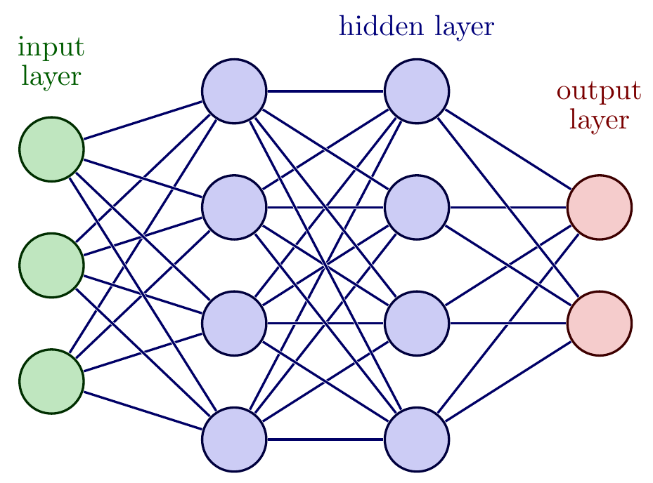

Visual representation of a sequential neural network

### General layer interface

We have defined a general _Layer_ interface, to be implemented by all the different layers we're going to use.\
This interface has two main method : **feed_forward** and **propagate_backward**, The _feed forward_ method takes the input vector $X \in \mathbb{R}^i$ as a parameter and returns the output vector $Y \in \mathbb{R}^j$ of the layer. The _propagate backward_ method take as parameters the layer output gradient $\frac{\partial C}{\partial Y}$ and return the layer input gradient $\frac{\partial C}{\partial X}$. We will cover the use of these functions later, alongside the theoretical explanation of those concepts.

### Dense layer

A dense layer, also known as _Linear layer_, is a layer where each input neuron is connected to every output neuron, each connection is called a _weight_. $w_{ij}$ is the weight connecting neuron $x_i$ (input) to neuron $y_j$ (output).

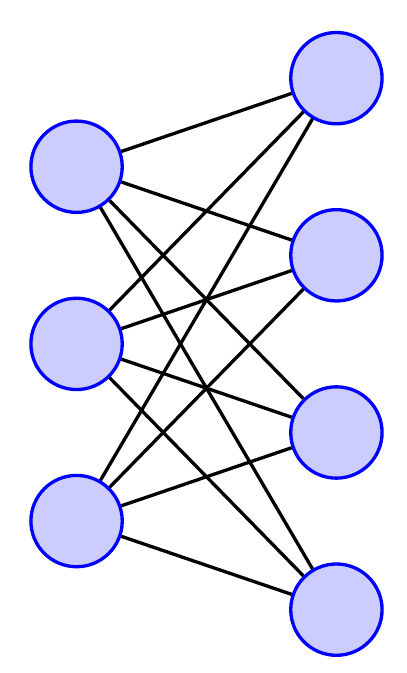

Dense Layer with 3 input nodes and 4 output nodes

We calculate a dense layer neuron output value $y_j$ as

$$
y_j = \sum_{i=1}^{n} x_i w_{i,j} + b_j
$$

which is the bias-corrected weighted sum of all the connected input nodes. $b_j$ is the bias term for the output neuron $j$. We can rewrite this operation to use matrix operation on whole vectors.

$$
Y = XW + B
$$

<!-- prettier-ignore -->
with $Y \in \mathbb{R}^j$, $X \in \mathbb{R}^i$, $W \in M_{i \times j}(\mathbb{R})$ and $B \in \mathbb{R}^j$\
In this report, we will annotate vectors : $X \in \mathbb{R}^N$, but note that to be able to do the matmul in practice, a vector will be broadcasted to a matrix $M_{1 \times i}(\mathbb{R})$

### Activation layer

Activation functions introduce non-linearity into the neural network. Without them, the network would be a series of linear transformations, regardless of the number of layers, making it equivalent to a single-layer model. Non-linear activation functions allow the network to learn to separate data in a non-linear way

There are two schools of thought for defining activations.

1. activations are used to produce the **output value inside** a dense layer, in this case, the weighted sum of the dense layer is called $z$, and $y$ is calculated by applying an activation $\sigma$ to $z$ : $y : \sigma(z)$.

2. activations are used **outside** the dense layer in this case, the output of a dense layer $y$ is equal to the weighted sum $z$. An activation layer is placed just after the dense layer, applying the activation function to each neuron.

We implemented our sequential neural network with the second paradigm, because it is easier in code to manage a dense and an activation layer separately, mainly for backpropagation calculation ease.

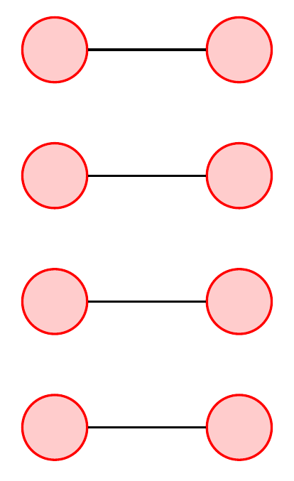

Activation layer with 4 input neuron

The Activation layer takes a vector $X \in \mathbb{R}^n$ as input and produces a vector $Y \in \mathbb{R}^n$ as output, with the activation function applied to each neuron.\
We must note that some activations function transform a vector by mapping the vector individual components $x$ through the function, like ReLU

$$
\operatorname{ReLU}(x) = \max(0, x)
$$

While other activation functions, like _softmax_ work on whole vectors. Softmax takes a vector $z \in \mathbb{R}^K$, and converts it into a probability distribution of $K$ possible outcomes.

$$
\sigma : \mathbb{R}^{K} \rightarrow (0, 1)^K, K \geq 1
$$

is computed by taking a vector $z = (z_1, \ldots, z_k) \in \mathbb{R}^K$ and compute each component of a vector $\sigma(\mathbf{z}) \in (0, 1)^K$

$$
\sigma(\mathbf{z})_i = \frac{e^{z_i}}{\sum_{j = 1}^{K} e^{z_j}}
$$

Current activations functions implemented in our library are :

- Sigmoid

- ReLU

- Tanh

- Softmax

## Cost function

To measure how well a neural network performs, we use a cost function, which outputs a real number by comparing the neural network _output_, and the _observed_ value. For the mnist dataset, the _output_ value is what the neural network guesses for the image we feed him with, and the _observed_ value is the real label for that image (the digit the image is).\
A simple cost function is the mean-squared error :

$$
\text{MSE} = \frac{1}{n} \sum_{i=1}^{n} (\hat{y}_i - y_i)^2
$$

The MSE function is great for regression neural networks when we want to predict a continuous value from an input.\
To do classification, like in the mnist data of handwritten digits, we use another cost function : the cross entropy cost function

$$
\text{Cross Entropy} = -\sum_{c=1}^{C} y_{c} \log(\hat{y}_{c})
$$

with $C$ the number of classes (e.g, 10 for the mnist dataset), $y_{c}$ the observed probability, and $\hat{y}_{c}$ the neural network output.\
This expression simplifies to

$$
\text{Cross Entropy} = -\log(\hat{y}_{c})
$$

if $y_{c}$ is one hot encoded (i.e, 1 for the observed class and 0 for others).

## The learning process

### Gradient

The gradient of a function $\nabla f$ is the vector field that represents the direction and rate of the quickest increase of the function from a point $p$.\
We can visualize the gradient and the curve of a function $f(x, y) = -(\cos^2 x +\cos^2 y)^2$\

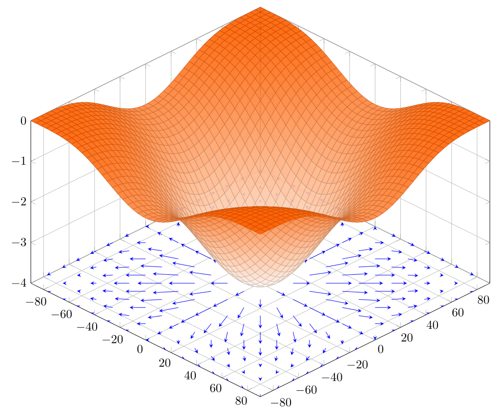

Function representation and gradient field of the function $-(\cos^2 x +\cos^2 y)^2$

The field vector below the function curve represents the gradient, for each point $p = (x, y)$ the arrow at $p$ point toward the direction with the fastest increase of $f$. This is useful in optimization problems when we want to find the maximum or the minimum of the function, because it indicates to us which direction to follow at a certain point, to maximize, or minimize the value of the function.

### Minimization

To make our neural network lean, we adjust its parameters (i.e, weights and biases for a dense layer) to **minimize the cost function $C$ of the network**. We can use the cost function gradient, which tells us the direction and magnitude of the fastest **increase** of cost, and proceed to go in the opposite direction, which will make us go toward the fastest **decrease** of the cost function.\
The algorithm used to minimize the cost function is the _gradient descent_, which will repeatedly descend the curve by going toward the opposite of the gradient of the cost function.

Here is the process for a single gradient descent step :

1. feeds all input data points into the network, calculating the cost for every output.

2. calculates the average cost.

3. computes the gradient of the averaged cost function **with respect to the network parameters**.

4. update the parameters in the opposite direction of the gradient

### backpropagation

To do a gradient descent step, we need the gradient of the cost function with respect to the neural network parameters $\frac{\partial C}{\partial P}$. The algorithm used to calculate this gradient is called **backpropagation**.\
Backpropagation precisely calculate (and not only estimate like the finite difference method) the gradient of the cost function $C$ with respect to the neural network parameters, which we will call parameters gradient $\frac{\partial C}{\partial P}$.\
The key mathematical tool used in backpropagation is the chain rule, which allows the gradient of the cost function to be split into a gradient of simpler functions at each neuron within the network.\
For each layer, $L_n$, to calculate the parameter's gradient $\frac{\partial C}{\partial P_n}$, we need to know the output gradient $\frac{\partial C}{\partial Y_n}$, this gradient is given to us by the next layer in the sequential order, because in the sequential architecture $\frac{\partial C}{\partial X_{n+1}} = \frac{\partial C}{\partial Y_n}$. We want to also calculate $\frac{\partial C}{\partial X_i}$, the input $X$ gradient, to transmit it to the previous layer, which needs it to calculate her own parameters gradient $\frac{\partial C}{\partial P_{i-1}}$.\
You can probably feel why this process is called backpropagation, we are sharing gradients, from layer to layer, starting at the last layer and going back up to the start of the net.\
Each layer will have her implementation of **propagate backward method**, in the next sections, we will cover the calculation for the layer we used in our library.

### Dense layer backpropagation

The dense layer has two trainable parameters, the weights $W$, and the biases $B$. Starting with the gradient of the cost function with respect to the weights, we are given the output gradient :

$$
\begin{aligned}
        \frac{\partial C}{\partial Y} &= \begin{bmatrix}
        \frac{\partial C}{\partial y_1} \\
        \frac{\partial C}{\partial y_2} \\
        \vdots \\
       \frac{\partial C}{\partial y_j} \\
    \end{bmatrix}
\end{aligned}
$$

The cost function $C$ depends on $Y$ which depend on $W$ thus $C$ depend on $W$ (chain rule)

$$
\frac{\partial C}{\partial W} = \frac{\partial C}{\partial Y} \frac{\partial Y}{\partial W}
$$

We calculate each weight gradient component $\frac{\partial C }{\partial W_{ij}}$

$$
\frac{\partial C}{\partial W_{ij}} = \sum_{l=1}^{N} \frac{\partial L}{\partial Y_{lj}} \frac{\partial Y_{lj}}{\partial W_{ij}}
$$

because $W_{ij}$ is used in every example for calculating the $j^{th}$ column of the output matrix. Let's look at the formula for $Y_{lj}$ to get the derivative,

$$
Y_{lj} = X_{l1}W_{1j} + \cdots + X_{li}W_{ij} + \cdots + X_{lp}W_{pj} + b_{j}
$$

$$
\frac{\partial Y_{lj}}{\partial W_{ij}} = X_{li}
$$

$$
\implies \frac{\partial C}{\partial W_{ij}} = \sum_{l=1}^{N} \frac{\partial C}{\partial Y_{lj}} X_{li} = \sum_{l=1}^{N} X^{T}_{il}\frac{\partial C}{\partial Y_{lj}}
$$

So finally

$$
\frac{\partial C}{\partial W} = X^{T} \frac{\partial C}{\partial Y}
$$

for the biases $B$.

$$
\begin{aligned}
        \frac{\partial C}{\partial b} &= \frac{\partial C}{\partial Y} \frac{\partial Y}{\partial b}\\
        \frac{\partial C}{\partial b_{i}} &= \sum_{l=1}^{N} \frac{\partial C}{\partial Y_{li}} \frac{\partial Y_{li}}{\partial b_i}
\end{aligned}
$$

since the bias term $b_{i}$ is used in the evaluation of the entire column of $Y$.

$$
\frac{\partial Y_{li}}{\partial b_{i}} = 1
$$

$$
\frac{\partial C}{\partial b_i} = \sum_{l=1}^{N} \frac{\partial C}{\partial Y_{li}}
$$

$$
\frac{\partial C}{\partial b} = \frac{\partial C}{\partial Y}
$$

and lastly, we calculate the gradient with respect to $X$

$$
\begin{aligned}
        \frac{\partial C}{\partial X} &= \frac{\partial C}{\partial Y} \frac{\partial Y}{\partial X}\\
        \frac{\partial C}{\partial X_{ij}} &= \sum_{l=1}^{k} \frac{\partial C}{\partial Y_{il}} \frac{\partial Y_{il}}{\partial X_{ij}}
\end{aligned}
$$

since the data point $i$ will only influence the data point $i$ in $Y$. Other data points will not be affected. Further, $X_{ij}$ is used in the calculation of every dimension of $Y_{i,:}$. To calculate the gradient,

$$
Y_{il} = \sum_{t=1}^{p} X_{it}W_{tl}
$$

$$
\frac{\partial Y_{il}}{\partial X_{ij}} = W_{jl}
$$

$$
\frac{\partial C}{\partial X_{ij}} = \sum_{l=1}^{k} \frac{\partial C}{\partial Y_{il}}W_{jl}
        = \sum_{l=1}^{k} \frac{\partial C}{\partial Y_{il}} W_{lj}^{T}
$$

$$
\implies \frac{\partial C}{\partial X} = \frac{\partial C}{\partial Y} W^{T}
$$

### Activation layer backpropagation

An activation layer doesn't have any trainable parameters. We just need to calculate the input gradient.\
We are given the output gradient $\frac{\partial C}{\partial Y}$, we know that

$$
\begin{aligned}
        Y &= \begin{bmatrix}
        f(X_1) \\
        f(X_2) \\
        \vdots \\
        f(X_i)
    \end{bmatrix}
\end{aligned}
$$

applying the chain rule like before,

$$
\frac{\partial C}{\partial X} = \frac{\partial C}{\partial Y} \frac{\partial Y}{\partial X}
$$

calculating each component

$$
\frac{\partial C}{\partial X_{ij}} = \sum_{l=1}^{N} \frac{\partial C}{\partial Y_{lj}} \frac{\partial Y_{lj}}{\partial X_{ij}}
$$

using the same procedure as for the previous calculations

$$
\implies \frac{\partial C}{\partial X} = \frac{\partial C}{\partial Y} \odot Y'
$$

with

$$
\begin{aligned}
        Y' &= \begin{bmatrix}
        f'(X_1) \\
        f'(X_2) \\
        \vdots \\
        f'(X_i)
    \end{bmatrix}
\end{aligned}
$$

## Optimizers

To update a neural network parameter $\theta$, we use the gradient descent formula, with a fixed learning rate $\eta$

$$
\theta := \theta - \eta \frac{\partial C}{\partial \theta}
$$

Updating the neural network layers parameters with this method is known, in the Keras API, as the _Stochastic gradient descent optimizer_, but other ways of updating layer parameters exist, we call those alternative methods **optimizers**. One of the best ones is Adam [\[5\]](#reference-5).

### Adam

Adam accelerates the convergence towards the optimal set of parameters by taking into account past gradient, it will also adapt the learning rate for each parameter.

ADAM initializes two vectors, $m$ and $v$, which store the exponential moving averages of past gradients and past squared gradients, respectively. These vectors are used to scale the gradient updates adaptively.

1. **Initialization:** Initialize two vectors, $m$ and $v$, to store the moving averages of the gradients and their squares, respectively.

2. **Computing Moving Averages of the Gradients:**

   $$
   \begin{aligned}
             m_t &= \beta_1 \cdot m_{t-1} + (1 - \beta_1) \cdot g_t, \\
             v_t &= \beta_2 \cdot v_{t-1} + (1 - \beta_2) \cdot g_t^2,
   \end{aligned}
   $$

   where $g_t$ is the gradient at time step $t$, and $\beta_1$ and $\beta_2$ are factors that control the decay rates.

3. **Bias Correction:** Correct initial bias in $m$ and $v$:

   $$
   \begin{aligned}
             \hat{m}_t &= \frac{m_t}{1 - \beta_1^t}, \\
             \hat{v}_t &= \frac{v_t}{1 - \beta_2^t}.
   \end{aligned}
   $$

4. **Update Weights:** Adjust weights based on the corrected moments:

   $$
   \theta_{t+1} = \theta_t - \frac{\eta}{\sqrt{\hat{v}_t} + \epsilon} \cdot \hat{m}_t,
   $$

   where $\theta$ are the parameters, $\eta$ is the learning rate, and $\epsilon$ is a small constant for numerical stability.

## Batching

We went through several feed-forward implementations in our code. The first one was to pass data points $x \in \mathbb{R}^{i}$ one by one, in the network. This was very slow, for example, for the mnist dataset, which has 60k training examples, we were going through the whole neural network: feed forward, cost evaluation, and back-propagation 60k times.\
We then learned that we can adapt our code to pass _a batch_ of data to the neural network, this batch can be of any length. The input then becomes, $x \in M_{n \times i}(\mathbb{R})$ with each line of the input matrix representing a single data point. The calculation became much faster because we can now feed $n$ element at a time in the neural network.

## Initializer

Initializers determine the starting weights of a neural network, it is important to choose the right initializer, depending on our network architecture, to avoid problems like vanishing or exploding gradients, and to optimize convergence. At the moment, we are writing this report, we have implemented two initializers inside our library,

1. he The _He_ initializer, designed for _ReLu_ activation functions, initializes weights from a normal distribution centered at zero with a standard deviation of $\sqrt{\frac{2}{n}}$ (where $n$ is the number of input nodes). This setup helps prevent the vanishing gradient problem in deep networks with _ReLu_ activations, ensuring that gradients remain large enough to sustain effective learning through many layers.

2. Conversely, the _Glorot Uniform_ initializer, also known as Xavier Uniform, is ideal for networks using _sigmoid_ or _Tanh_ activations. It selects weights from a uniform distribution within $[-c, c]$, where $c = \sqrt{\frac{6}{n_{\text{in}} + n_{\text{out}}}}$. This approach maintains a balance in the variance of neurons' outputs across the network, aiding in stable gradient flow in deep networks with saturating activations.

## Convolutional neural network

A convolutional neural network is a type of neural network mainly used for image recognition. The main use of this network is to offer translation invariance, meaning that it can recognize objects regardless of their position in the input image, compared to the multilayer perceptron presented earlier.

First of all, convolution neural networks are inspired by the way the human brain recognizes shapes. In human recognition, when we look at an object, a visual signal passes successively through filters in the primary visual cortex, then in subsequent areas, to finally ignite a set of neurons in the inferotemporal cortex representing the concept of the object.

### Convolutional layer

In the primary visual cortex, each packet of neurons is connected to a small area of the visual field called the receptive fields. Each neuron in this packet will react to a simple pattern present in the receptive field. For example, one neuron will recognize vertical lines, another horizontal lines, etc...

The area of primary visual cortex is covered by packets of neurons whose receptive field is a small area offset from the previous packet. The entire visual field is thus lined with these neuron packets.

This way of recognizing is reused in convolution layers. Each neuron in the packet is called a filter (or kernel) and symbol recognition is calculated via a mathematical operation called convolution, which has computational similarities with the neurons of the visual cortex.

Convolution is a mathematical filtering operation that involves calculating a weighted sum over the filter and dragging this filter over the input image. These different weighted sums are then recorded in the output image :

$$
S_{ij} = b + (X * K)_{ij} = b + \sum_{m=0}^{M-1} \sum_{n=0}^{N-1} X_{i+m, j+n} \cdot K_{m, n}
$$

Where:

- $X$ is the input image,

- $K$ is the convolutional filter (or kernel),

- $S$ is the resulting feature map,

- $i, j$ are the indices of the position in the feature map,

- $M, N$ are the dimensions of the filter.

- $b$ is the bias.

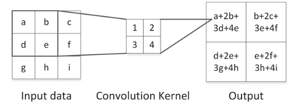

The convolution operation

An image can also have several channels, as in the case of color images, which use 3 channels, one for each of the colors red, green and blue. In our case, with MNIST, we have a grayscale image.

Each filter will then pass over all the image channels and perform the convolution operation to produce resulting feature maps. These feature maps detects the few elements of the input image and sends them to the following layers.

The dimensions of the output feature map $Y$ after applying the convolution can be calculated as:

$$
H_{\text{out}} = H - F + 1
$$

$$
W_{\text{out}} = W - F + 1
$$

where:

- $H$ is the height of the input feature map.

- $W$ is the width of the input feature map.

- $F$ is the size of the filter (kernel).

- $H_{\text{out}}$ is the height of the output feature map.

- $W_{\text{out}}$ is the width of the output feature map.

### Convolutional layer backpropagation

Like the other layers, the convolutional layer is trainable, and the weights correspond to the values of the various filters. These filters are updated according to the following formulas.

#### Gradient with respect to the input $X$

$$
\frac{\partial L}{\partial X_{i,j}} = \sum_{m=0}^{M-1} \sum_{n=0}^{N-1} \frac{\partial L}{\partial Y_{i-m,j-n}} \cdot K_{m,n}
$$

- $\frac{\partial L}{\partial X_{i,j}}$: The gradient of the loss $L$ with respect to the input $X$ at position $(i, j)$.

- $\frac{\partial L}{\partial Y_{i-m,j-n}}$: The gradient of the loss $L$ with respect to the output $Y$ at position $(i-m, j-n)$.

- $K_{m,n}$: The filter value at position $(m, n)$.

#### Gradient with respect to the weights (filters)

$$
\frac{\partial L}{\partial K_{m,n}} = \sum_{i=0}^{H-1} \sum_{j=0}^{W-1} \frac{\partial L}{\partial S_{ij}} \cdot X_{i+m, j+n}
$$

Where:

- $\frac{\partial L}{\partial K_{m,n}}$ is the gradient of the loss with respect to the filter at position $(m, n)$.

- $\frac{\partial L}{\partial S_{ij}}$ is the gradient of the loss with respect to the feature map at position $(i, j)$.

- $X_{i+m, j+n}$ is the input value at position $(i+m, j+n)$.

#### Gradient with respect to the biases

$$
\frac{\partial L}{\partial b} = \sum_{i=0}^{H-1} \sum_{j=0}^{W-1} \frac{\partial L}{\partial S_{ij}}
$$

Where:

- $\frac{\partial L}{\partial b}$ is the gradient of the loss with respect to the bias.

### Pooling layer

In addition to convolution layers, a convolutional network contains pooling layers. These layers reduce the dimensionality of the convolution layer while retaining important features. They also ensure that the network is invariant to small translations. We're going to define a patch size that will pass over the feature map to retrieve the average or maximum value of the feature map region contained in the patch.

There are two types of pooling layer:

- **average pooling** : recovers the average value of the patch

- **max pooling** : recovers the maximum value of the patch

In the case of MNIST, we decided to implement the max pooling layer, which is more efficient for this dataset.

The dimensions of the output feature map $Y$ after Max Pooling can be calculated as:

$$
H_{\text{out}} = \left\lfloor \frac{H}{p} \right\rfloor
$$

$$
W_{\text{out}} = \left\lfloor \frac{W}{p} \right\rfloor
$$

where:

- $H$ is the height of the input feature map.

- $W$ is the width of the input feature map.

- $p$ is the size of the pooling window.

- $H_{\text{out}}$ is the height of the output feature map.

- $W_{\text{out}}$ is the width of the output feature map.

- $\left\lfloor \cdot \right\rfloor$ denotes the floor function, which rounds down to the nearest integer.

The max pooling layer formula is :

$$
Y_{i,j} = \max_{0 \leq m < p, 0 \leq n < p} X_{i \cdot p + m, j \cdot p + n}
$$

where:

- $Y_{i,j}$ is the value at position $(i, j)$ in the output feature map.

- $X$ is the input feature map.

- $p$ is the size of the patch.

- $X_{i \cdot p + m, j \cdot p + n}$ refers to the value at position $(i \cdot p + m, j \cdot p + n)$ in the input feature map, within the current patch.

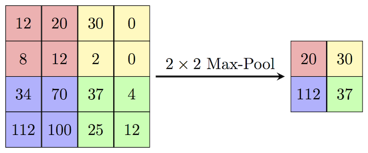

Max pooling operation

### Max pooling layer backpropagation

The max pooling layer is not trainable, but the gradient must be propagated to the lower layers.

To do this, we use this formula :

$$
\delta_{mn}^{\text{in}} =
    \begin{cases}
    \delta_{i,j}^{\text{out}} & \text{if } X_{i \cdot p + m, j \cdot p + n} \text{is the max patch value} \\
    0 & \text{otherwise}
    \end{cases}
$$

where:

- $\delta_{ij}^{\text{out}}$ is the gradient of the loss with respect to the output of the Max Pooling layer at position $(i, j)$.

- $X_{i \cdot p + m, j \cdot p + n}$ is the input value at position $(i \cdot p + m, j \cdot p + n)$.

- $p$ is the size of the patch.

## Metrics

The mnist dataset, is a classification problem, we can implement multiple metrics to evaluate the network performances, we will explain the one we implemented in our library.

1. Accuracy measures the proportion of correct prediction to the total observations in the dataset. for example, if we have correctly classified 950 images out of 1000, the accuracy will be 95 percent.

   $$
   \text{Accuracy} = \frac{\text{Number of Correct Predictions}}{\text{Total Number of Predictions}}
   $$

   Precision and Recall are two metrics acting on a specified class. **Retrieved elements** are all the network predictions for a specific class. **Relevant elements** are all the correct instances of the class [\[2\]](#reference-2).

2. Precision answer the question : _How many retrieved items are relevant_

   $$
   \text{Precision} = \frac{\text{Relevant retreived instance}}{\text{All retrieved instance}}
   $$

3. Recall answers the question: _How many relevant items are retrieved_

   $$
   \text{Recall} = \frac{\text{Relevant instances}}{\text{All relevants instance}}
   $$

Those metrics are important to evaluate the network performances, in our implementations and results analysis, we focused on cost and accuracy, but recall, precision, and other classification metrics can be useful to know on which specific digits the neural network is making mistakes.

## Training, Validation, and Test Sets

To monitor the performances of a neural network effectively, it is important to break down the dataset into three distinct subsets: training, validation, and test sets.

- **Training set**: Is used during the learning phase, with training data directly influencing the parameter updates

- **Validation set**: Is used to provide an unbiased evaluation of a model fit on the training dataset while tuning the model's hyperparameters. This set is used during training, to prevent overfitting when the model performs well on the training data but poorly on unseen data.

- **Test set**: Is used only after the model's training and validation phases are complete. It provides the final, unbiased performance metric of the neural network.

## Results

### Network declaration

We include a small code snippet, showing our custom library API to declare a sequential neural network. You can find the API for a sequential network declaration inside the [sequential module](https://github.com/dirdr/neural_network_from_scratch/blob/main/nn_lib/src/sequential.rs), and the declaration of the mnist network in the [network declaration module](https://github.com/dirdr/neural_network_from_scratch/blob/main/mnist/src/network_definition.rs)

```rust
let net = NeuralNetworkBuilder::new()
    .push(DenseLayer::new(
        784,
        32,
        InitializerType::He,
    ))
    .push(
        ActivationLayer::from(Activation::ReLU)
    )
    .push(
        DenseLayer::new(32, 10, InitializerType::He)
    )
    .push(
        ActivationLayer::from(
            Activation::Softmax
        )
    );
    .watch(MetricsType::Accuracy)
Ok(net.compile(GradientDescent::new(0.01), CostFunction::CrossEntropy)?)
```

The layers are added in sequential order with the push method. the _watch_ method will add a _MetricsType_ to the list of metrics that the program needs to calculate, in the example we watched the accuracy metrics. those metrics are given by epochs for the training and validation dataset. and at the end of the test dataset.

### Vapnik–Chervonenkis tradeoff

To create a great network, we will try to reach the _VC trade-off principle_ [\[7\]](#reference-7) [\[9\]](#reference-9), this principle states that:

1. A more complex model might fit the training data very well (low training error) but risks overfitting, meaning it could perform poorly on new data because it is too tailored to the training set (high variance).

2. A less complex model might not fit the training data as closely (higher training error) but can generalize better on new data because it does not capture the noise and specific details of the training set (low variance).

Our challenge will thus be, to find the right level of complexity that minimizes both the error on the training data.

### Multi-layer perceptron

#### Overfitting

We will analyze the result of an overfitting model, to see how this behavior translates into metrics. To make a model overfit, we have multiple options

- increase the model complexity (number of hidden layers, number of neurons per layer)

- reduce the batch size to make the learning process very granular and increase the chance of the network learning too many specific patterns

In our case we have chosen to lower the batch size, here are our network hyperparameters

| hyperparameters | epochs | batch size |
| :-------------- | :----: | :--------: |
| Value           |   30   |     5      |

hyperparameters overfitting model

Here is the cost comparison, over 30 epochs between the training cost, and the validation cost.

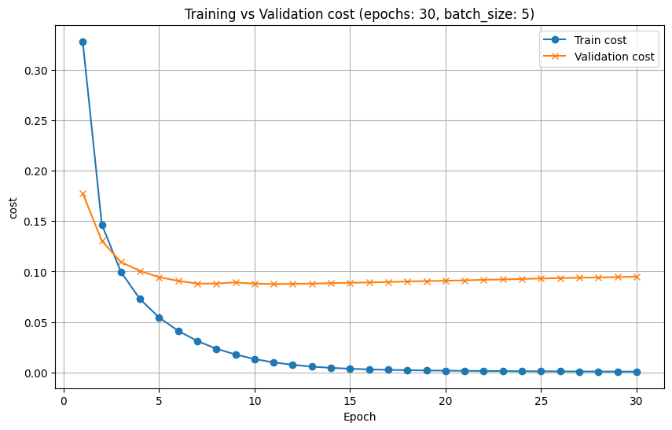

Training vs. Validation cost overfitting model

The overfitting stands out, our train cost gets very low, while the validation cost remains stable this means that our neural network has learned too many specific patterns in the training data, making the error go very low on this set, but on the validation set, the network doesn't generalize well

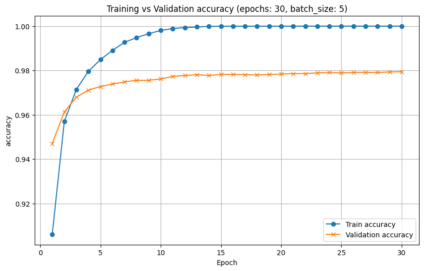

Training vs. Validation cost overfitting model

The same observation applies to the evolution of accuracy over epochs. Accuracy reached a stunning 100 percent on our training data, meaning that it doesn't make any mistakes, but the validation accuracy struggles to get over 98 percent.\

#### Greatfitting

We have achieved our best generalization with the following hyperparameters and network definitions.

| hyperparameters | epochs | batch size |
| :-------------- | :----: | :--------: |
| Value           |   15   |    100     |

hyperparameters great fitting model

```rust
let net = SequentialBuilder::new()
    .push(
        DenseLayer::new(784, 256,
        InitializerType::He))
    .push(
        ActivationLayer::from(
            Activation::ReLU)
        )
    .push(
        DenseLayer::new(256, 256,
        InitializerType::He))
    .push(
        ActivationLayer::from(
            Activation::ReLU)
        )
    .push(
        DenseLayer::new(256, 10,
        InitializerType::GlorotUniform))
    .push(
        ActivationLayer::from
        (
            Activation::Softmax)
        )
    .watch(MetricsType::Accuracy);
Ok(net.compile(GradientDescent::new(0.04), CostFunction::CrossEntropy)?)
```

Here is the comparison between the training cost and the validation cost :

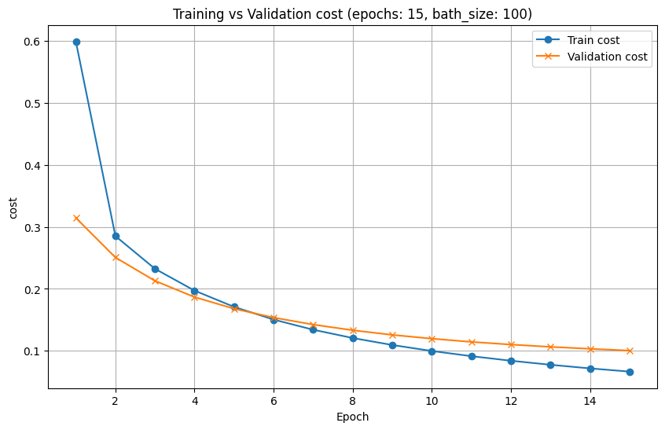

Training vs. Validation cost great fitting model

Here, our model seems to have generalized patterns, because the training cost and the validation cost follows the same path, slowly increasing, with the gap between curves never blowing off the roof. We reach a validation cost of 0.097, and the cost for the testing data set is 0.091.

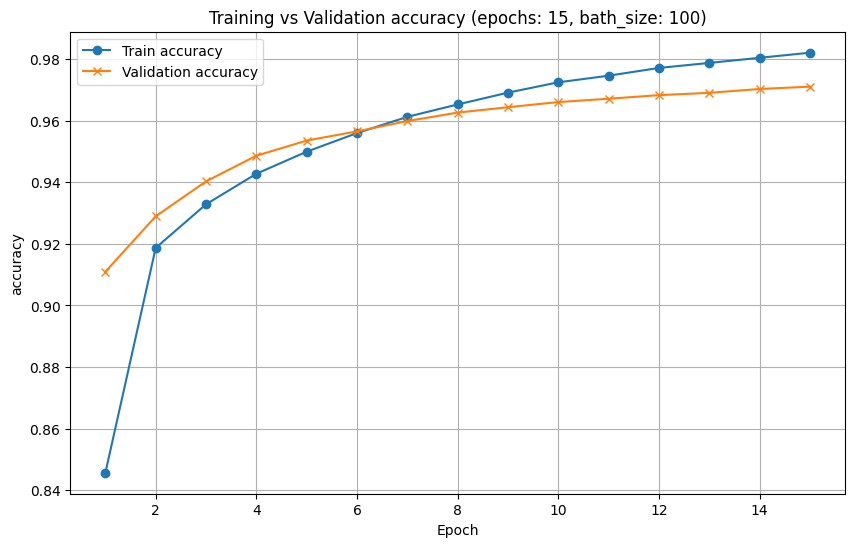

Training vs. Validation cost great fitting model

We reach a validation accuracy of 97.10 percent for the final epochs, and the accuracy for the testing data set is 97.31 percent. which is not a _state-of-the-art_ accuracy, but is a good result.

### Convolutional multi-layer perceptron

We have used this hyperparameters and network definitions

| hyperparameters | epochs | batch size |
| :-------------- | :----: | :--------: |
| Value           |   10   |    128     |

hyperparameters convolutional neural network

```rust
let net = SequentialBuilder::new()
.watch(MetricsType::Accuracy)
.push(ReshapeLayer::new(&[28 * 28], &[28, 28, 1])?)
.push(ConvolutionalLayer::new(
    (28, 28, 1),
    (3, 3),
    5,
    InitializerType::He,
))
.push(
ActivationLayer::from(Activation::ReLU)
)
.push(MaxPoolingLayer::new(
    (26, 26, 5),
    (2, 2)
))
.push(ReshapeLayer::new(&[13, 13, 5], &[13 * 13 * 5])?)
.push(DenseLayer::new(
    13 * 13 * 5,
    100,
    InitializerType::GlorotUniform,
))
.push(
ActivationLayer::from(Activation::ReLU)
)
.push(DenseLayer::new(100, 10, InitializerType::GlorotUniform))
.push(
ActivationLayer::from(Activation::Softmax)
);
Ok(net.compile(GradientDescent::new(0.01), CostFunction::CrossEntropy)?)
```

Here is the comparison between the training cost and the validation cost :

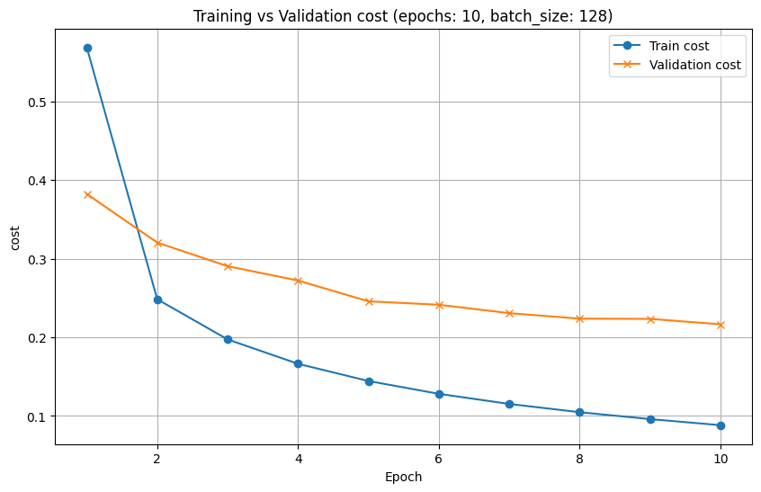

Training vs. Validation cost convolutional model

The training and validation cost decreases as the number of epochs increases but the gap between the training and validation cost indicates some degree of overfitting. We reach a training cost of 0.09 and a validation cost of 0.22.

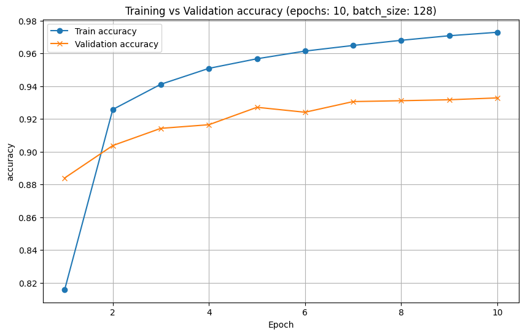

Training vs. Validation accuracy convolutional model

The training accuracy increases quickly and stabilizes around 0.97. The model quickly learned to correctly classify the training data. The validation accuracy also increases but at a slower rate compared to the training accuracy. It stabilizes around 0.93. So, the model has a good generalization but it seems to be overfitted.

## Conclusion

This project of creating our own _from scratch_ library has brought us a lot of knowledge, It has made us greatly understand the whole neural network process. We have planned to add more functionality to our library and optimize the code base even after the end of this project. We want to add more optimizers, the dropout layer, and a learning rate scheduler. and over the longer term, we'd like to add other neural network paradigms, such as Recurrent neural networks, and use our library for our experiments with deep learning!

## References

<span id="reference-1"></span>

[1] Papers with Code. “He Initialization”. n.d. <https://paperswithcode.com/method/he-initialization>.

<span id="reference-2"></span>

[2] Wikipedia contributors. 2024. _Precision and Recall - Wikipedia, the Free Encyclopedia_. <https://en.wikipedia.org/wiki/Precision_and_recall>.

<span id="reference-3"></span>

[3] Stack Exchange. 2016. “Backpropagation with Softmax Cross Entropy.” <https://stats.stackexchange.com/questions/235528/backpropagation-with-softmax-cross-entropy>.

<span id="reference-4"></span>

[4] Google. 2024. “Cross Entropy.” <https://www.google.com/search?q=cross+entropy&sourceid=chrome&ie=UTF-8>.

<span id="reference-5"></span>

[5] Kingma, Diederik P., and Jimmy Ba. 2017. _Adam: A Method for Stochastic Optimization_. <https://arxiv.org/abs/1412.6980>.

<span id="reference-6"></span>

[6] V7 Labs. “A Guide to Cross-Entropy Loss”. n.d. <https://www.v7labs.com/blog/cross-entropy-loss-guide>.

<span id="reference-7"></span>

[7] LeCun, Yann. 2019. _Quand La Machine Apprend: La révolution Des Neurones Artificiels Et de l'apprentissage Profond_. Odile Jacob.

<span id="reference-8"></span>

[8] Towards Data Science. 2019. “Derivative of the Softmax Function and the Categorical Cross Entropy Loss.” <https://towardsdatascience.com/derivative-of-the-softmax-function-and-the-categorical-cross-entropy-loss-ffceefc081d1>.

<span id="reference-9"></span>

[9] Vapnik, Vladimir, and Alexey Chervonenkis. 1974. _Theory of Pattern Recognition_.

<span id="reference-10"></span>

[10] Wikipedia. 2024a. “Hadamard Product (Matrices).” <https://en.wikipedia.org/wiki/Hadamard_product_(matrices)>.

<span id="reference-11"></span>

[11] Wikipedia. 2024b. “One-Hot.” <https://en.wikipedia.org/wiki/One-hot>.

<span id="reference-12"></span>

[12] Wikipedia. 2024d. “Softmax Function.” <https://en.wikipedia.org/wiki/Softmax_function>.

<span id="reference-13"></span>

[13] Wikipédia. 2024. “Matrice Jacobienne.” <https://fr.wikipedia.org/wiki/Matrice_jacobienne>.
